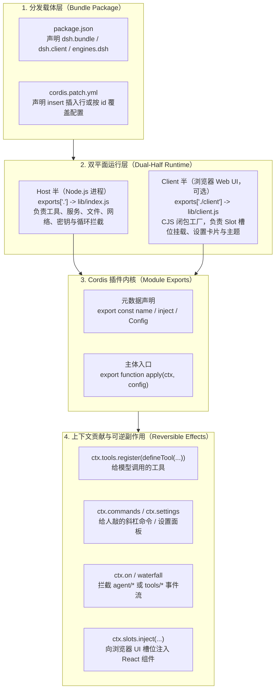

### **一个完整的 DeepSeek Harness（`dsh`）插件在工程上是一个附带 `dsh.bundle` 清单与 `cordis.patch.yml` 配置层的 ESM 模块包，在运行时则是基于 Cordis 上下文（`ctx`）注入依赖、挂载服务或事件，并通过可逆副作用（`effect`）管理生命周期的 Host/Client 双平面单元。开发前需重点获取目标扩展点（工具、服务 Seam、事件或 UI 槽位）、运行环境版本约束（`engines.dsh`）以及数据与权限边界这三类核心要素。**

---

### 高价值参考清单：

| 类别 | 资源名称与直链 | 核心价值与阅读定位 |
|---|---|---|
| 官方独立文档站 | [deepseek-harness.github.io](https://deepseek-harness.github.io/deepseek-harness/) | 仓库 `docs/` 的在线渲染版，阅读体验优于直接翻阅仓库源码（对应清单 #2 勘误） |
| 官方开发实操手册 | [docs/cookbook/](https://github.com/deepseek-ai/deepseek-harness/tree/master/docs/cookbook) & [docs/subsystems/](https://github.com/deepseek-ai/deepseek-harness/tree/master/docs/subsystems) | `cookbook` 提供加工具、加包、加设置卡的分步指南；`subsystems` 包含自动生成的 `cordis-surface` 服务与事件签名权威目录 |
| 官方破坏性升级指南 | [docs/upgrade-guide/](https://github.com/deepseek-ai/deepseek-harness/tree/master/docs/upgrade-guide) | `dsh` 处于快速迭代的开发者预览期（目前已演进至 `v0.2.x`），写代码前必查 API 废弃与迁移记录 |
| 实战踩坑长文（直链） | [Discussion #961](https://github.com/deepseek-ai/deepseek-harness/discussions/961) / [Discussion #5039](https://github.com/deepseek-ai/deepseek-harness/discussions/5039) / [知乎 Cordis 实战](https://zhuanlan.zhihu.com/p/2072713854056915116) | 补全清单 #6 直链：涵盖 `dsh-report-studio`、`dsh-session-recall` 等真实插件从编码、测边界到发 npm 的全流程复盘 |
| Jev 决策引擎生态 | [buberlo/dsh-jev](https://github.com/buberlo/dsh-jev) & [Discussion #8155](https://github.com/deepseek-ai/deepseek-harness/discussions/8155) | 补全清单 #7 实例：展示如何将运行时无关的纯决策核（如 `jevcore`）绑定到 `dsh` 扩展点与子代理路由 |
| 社区插件市场与索引 | [dsh-plugin.org](https://dsh-plugin.org) & [awesome-dsh-plugin](https://github.com/awesome-dsh-plugin/awesome-dsh-plugin) | 收录数千个社区插件及 `dsh-plugin-hub` 市场前端，用于开发前查重、寻找同类开源参考实现 |
| 底层理论基础 | [Cordis 框架仓库](https://github.com/cordiverse/cordis) & [时空可组合性论文](https://arxiv.org/abs/2608.25512) | 理解 `dsh` 为什么没有“特权内核”，掌握空间可组合性（依赖驱动）与时间可组合性（副作用自动回滚）的底层逻辑 |

[GitHub](https://github.com/deepseek-ai/deepseek-harness) [DSH Plugin Market](https://dsh-plugin.org)

---

### **二、 解剖 dsh 插件：它到底由什么组成？**

在 DeepSeek Harness 中，“一切皆插件”并非营销修辞——模型适配器、工具注册表、会话持久化、Web 界面甚至 `agent-loop`（智能体主循环）本身，都是地位平等的插件。剥开一个标准 `dsh` 插件包，它在物理文件和运行时架构上由以下四个核心部分组成：



#### **1. 分发与组装层：Bundle 清单与 Patch 补丁**
在工程目录中，你编写并发布的插件包被称为 **Bundle（组合包）**，而用户实际启动的环境（如 `web`、`headless`、`sdk`）被称为 **Profile**。一个可安装的插件包至少包含三个物理要素：
- **`package.json`（清单契约）**：必须是 ESM 包（`"type": "module"`），通过 `"dsh": { "bundle": { "patch": "./cordis.patch.yml" } }` 声明自己贡献一个配置层，并通过 `"engines": { "dsh": ">=0.2.0 <0.3.0" }` 声明兼容的宿主版本范围（自 `v0.2.1` 起宿主启动会强制校验版本兼容性）。[GitHub](https://raw.githubusercontent.com/deepseek-ai/deepseek-harness/master/docs/user/develop/basic/publish.zh.md) [dsh-handbook](https://github.com/Electricitysheep/dsh-handbook)
- **`cordis.patch.yml`（挂载补丁）**：插件代码本身不包含“把自己挂到哪里”的信息，而是靠这份 YAML 补丁通过 `- insert:` 插入新插件行，或者按 `id` 整块替换已有插件行的 `config`。启动时，`dsh` 会按 `内置 bundle -> profile patch -> 全局 home patch -> --patch 命令行覆盖层` 的顺序叠成最终的插件树。[GitHub](https://raw.githubusercontent.com/deepseek-ai/deepseek-harness/master/docs/architecture.zh.md)
- **模块入口文件**：构建后的 JS 产物（如 `lib/index.js`），以及 `files` 字段中显式包含的构建产物与补丁文件（缺漏任何一项都会导致“安装成功但静默不生效”）。[DSH Plugin Market](https://dsh-plugin.org/tutorials/develop-plugin-npm)

#### **2. 运行平面层：Host 半与 Client 半（一个包，两副面孔）**
`dsh` 运行在两套独立的 Cordis 插件树上，同一个 npm 包可以只包含后端，也可以同时横跨前后端：
- **Host 半（Node 进程侧，必选）**：由 `exports["."]` 导出，运行在宿主机 Node.js 环境中，持有文件系统、子进程、网络请求、API 密钥与会话日志权限。绝大多数工具类、策略拦截类、MCP 桥接类插件只需要写 Host 半（哪怕是纯前端 UI 插件，也必须保留一个导出空 `apply` 的 Host 入口，以便宿主扫描发现该包）。[GitHub](https://raw.githubusercontent.com/anweat/dsh-plugin-dev-guide/main/docs/plugin-frontend.md)
- **Client 半（浏览器侧，按需可选）**：当插件需要在 Web UI 中加按钮、加侧边栏面板、自定义工具渲染卡片或设置页卡片时，需在 `package.json` 中额外声明 `"dsh": { "client": { "platform": "web", "inject": [...] } }` 并暴露 `exports["./client"]`。它必须被打包成特定的 CJS 闭包工厂（向 `window.__ModuleLoader__.load` 注册），复用浏览器壳预置的 React 与 `ui-slots` 共享实例，严禁跨插件直接值导入内部包。[GitHub](https://raw.githubusercontent.com/anweat/dsh-plugin-dev-guide/main/docs/plugin-frontend.md)

#### **3. 代码内核层：Cordis 模块的四大命名导出**
打开任何一个插件的源码入口，它的主体结构都非常干净，没有任何框架引导样板代码，通常由四个**命名导出（禁止使用 `export default` 混搭，否则 Loader 可能丢失元数据）**构成：
- **`export const name = 'my-plugin'`**：诊断与日志中显示的插件标识名。
- **`export const inject = ['tools', 'sessions']`**：空间可组合性的核心。声明插件运行所必需的服务键名，Cordis 的 Fiber 状态机会让插件保持 `PENDING`，直到这些服务全部就绪才执行 `apply`；一旦运行期某个上游服务卸载，本插件也会自动挂起并在服务恢复后重连。[知乎专栏](https://zhuanlan.zhihu.com/p/2072713854056915116) [GitHub](https://raw.githubusercontent.com/deepseek-ai/deepseek-harness/master/docs/cordis-primer.zh.md)
- **`export const Config: Schema<Config> = Schema.object(...)`**：基于 `@deepseek-ai/schemastery` 定义的配置校验器与默认值字典。用户在 `cordis.patch.yml` 里写的 `config` 会在加载期自动校验并注入。[DEV Community](https://dev.to/henry_lin_3ac6363747f45b4/deepseek-harness-dsh-cha-jian-kai-fa-jiao-cheng-4h6j)
- **`export function apply(ctx: Context, config: Config)`**：插件的唯一激活入口（当插件是要向其他插件暴露新接口的底层能力时，也可以写成继承自 `Service` 的子类）。

#### **4. 能力贡献层：可逆副作用（Reversible Effects）**
在 `apply(ctx)` 内部，插件从不直接 `import` 其他组件的实现代码，而是把 `ctx` 当作共享服务仓库，通过 `ctx.<service>` 或事件总线挂载能力：
- **面向模型的能力（消耗 Token）**：通过 `ctx.tools.register(defineTool({ name, description, parameters, output, execute }))` 注册工具，其参数 Schema 会自动汇入系统提示词，且天然兼容标准模式与 PTC（代码组合调用）模式；或通过 `agent.inject()` 注入上下文。[GitHub](https://raw.githubusercontent.com/deepseek-ai/deepseek-harness/master/docs/cookbook/adding-a-tool.zh.md)
- **面向人类的能力（零 Token）**：通过 `ctx.commands` 注册 `/xxx` 斜杠命令，通过 `installSettingsSection` 注册持久化到 `settings.yaml` 的配置命名空间，或在 Client 半通过 `ctx.slots.inject('<slot-name>', ...)` 挂载界面组件。[GitHub](https://github.com/deepseek-ai/deepseek-harness/discussions/5039)
- **流程拦截与观测**：通过 `ctx.on()` 监听持久会话事件（`session/event`）、实时循环事件（如 `agent/pre-step`、`agent/request`）或工具流水线事件（`tools/pre-execute`、`tools/post-execute`）。所有注册行为都是受追踪的**可逆副作用**（自定义定时器或句柄则包在 `ctx.effect(() => () => cleanup())` 中），当插件热重载（HMR）或停用时，框架会按逆序自动清理一切痕迹，不会留下孤儿监听器。[GitHub](https://raw.githubusercontent.com/anweat/dsh-plugin-dev-guide/main/docs/plugin-development.md)

---

### **三、 如何研究与设计一个 dsh 插件？（四步方法论）**

官方开发准则里有一条铁律：**“Plugins, not loop changes —— 新行为挂载到已有文档记录的扩展点上，不要去 Fork 或修改主循环。”** 想要从零设计一个高质量插件，建议遵循以下研究与架构步骤：

#### **第一步：定位“行为归属”，选准最小扩展面**
动手前先查阅官方仓库的 `docs/architecture.md`（“新行为的归属位置”表）和 `docs/capability-seams.md`，把你的想法拆解到正确的机制上，避免用错锤子：
- 如果你想**给模型增加外部动作或信息源**（如查数据库、生成周报、调内部 API），设计为 **`ctx.tools` 工具插件**；如果这项动作人也会高频手动触发且不需要模型推理（如一键导出会话为 Markdown），优先做成 **`ctx.commands` 斜杠命令**，既快又省 Token。
- 如果你想**改变 Agent 的运行策略、省钱提速或做安全门禁**（如根据历史工具复杂度动态降级推理档位、拦截高危目录写入、自动裁剪超长工具返回），不要重写工具本身，而是去挂载 **Waterfall（瀑布式环绕中间件）事件**，例如 `agent/pre-step`、`agent/request` 或 `tools/pre-execute`。
- 如果你要**接入一类全新的底层基础设施**（例如把本地文件系统换成云端沙箱、接入新的搜索引擎或语音识别后端），应当遵循官方的 **Capability Seam（三方能力缝）模式**：将能力拆解为 `Service Definition`（抽象接口声明）、`Service Provider`（具体后端实现）和 `Consumer`（暴露给模型的工具）三个独立角色，或直接实现官方已有的 Seam（如往 `ctx.web`、`ctx.llm`、`ctx.subagents` 注册新 Provider）。[GitHub](https://raw.githubusercontent.com/deepseek-ai/deepseek-harness/master/docs/capability-seams.zh.md)
- 如果需要**扩展 Web 界面**，遵循“增量槽位（Additive Slot）优先”原则：往 `conversation.input.left`（输入框旁按钮）、`settings.plugin.item`（插件配置卡片）、`tool.call.toolview`（专属工具卡片）或 `shell.overlay`（全局浮层）注入组件，切忌覆盖 `root`、`sidebar` 或 `conversation` 等父级 `single` 槽位，否则会把官方原有的整片子槽位全部抹掉。

#### **第二步：用 `--dump-config` 摸底真实运行树与同行源码**
文档有时会滞后于快速迭代的预览版代码，最可靠的调研手段是直接让 `dsh` 打印出当前机器合成的真实插件树：
```bash
dsh --profile web --dump-config
```
这条命令会带来源注释打印出整个运行时的插件装配表。结合官方仓库 `docs/subsystems/*.md` 中自动生成的 `cordis-surface` 接口签名，你可以立刻看清官方内置包是怎么写的。比如想写工具就去读 `packages/todo/tool-todo` 或 `packages/shell/tool-bash`，想写前端槽位就去读 `packages/client/ui-skill`，找准一个体量接近的官方包或社区开源包做原型参照。

#### **第三步：“纯函数内核 + 薄插件胶水层”解耦设计**
这是社区实战（如 `dsh-handbook` 的提速插件与 `buberlo/dsh-jev` 决策引擎）验证过的最佳架构模式：**把所有业务计算、文本解析、策略判断、模板渲染抽成零框架依赖的纯 TypeScript 函数，放在独立的 `core/` 或 `lib/` 目录下；`src/index.ts` 里的 `apply(ctx)` 只做最薄的一层事件接线与服务转发。**
这样做有两个巨大收益：一是单元测试不需要启动庞大的 `dsh` 进程、不需要消耗真实的模型 API Key，用 `vitest` 或 `node:test` 在毫秒级就能跑完所有边界分支；二是当未来 `dsh` 发生破坏性 API 变更（甚至你想把同一套逻辑同步移植到 MCP Server 或其他 Agent 框架）时，核心代码一行都不用改。[GitHub](https://raw.githubusercontent.com/Electricitysheep/dsh-handbook/main/docs/04-plugin-dev.md) [GitHub](https://github.com/buberlo/dsh-jev)

#### **第四步：遵循三层验证闭环与安全红线设计**
设计阶段就要把运行期边界考虑进去：
1. **纯函数单测层**：覆盖空输入、非法占位符、中文分词/编码边界等极端情况。
2. **契约 Mock 测试层**：构造最小 `Context` 替身，验证 Waterfall 监听器是否严格执行了 `await next()` 并保留了上游字段（漏掉 `await` 会导致下游拿到空对象，直接弄丢模型与 Provider 配置），验证插件卸载时资源是否干净释放。
3. **无构建覆盖层实机冒烟**：开发期无需反复打包安装，直接写一个临时 `dev.patch.yml` 指向本地 `.ts` 源码绝对路径，用 `dsh web --patch ./dev.patch.yml` 或 `dsh --profile headless --patch ./dev.patch.yml "测试任务"` 在真实 Agent 循环中验证端到端效果。

---

### **四、 开发前必须获取与核实的“基本要素清单”**

在正式新建仓库敲代码之前，请逐项收集并确认以下六个维度的基本要素，它们直接决定了你的插件能否顺利编译、加载和发布：

| 要素维度 | 具体需要获取的信息 | 获取方式与关键避坑提示 |
|---|---|---|
| **1. 运行环境与版本基线** | 目标 DSH 版本号、Node.js 版本、包管理器版本 | 当前新版本要求 Node.js `>=24.9`（早期版本 `^22.19 \|\| >=24`），源码环境绑定 Corepack `pnpm@11.7.0`。安装 `@deepseek-ai/*` 类型依赖时切勿盲信 npm 的 `latest` tag（可能指向废弃的 `0.0.1-rc.1`），务必用 `npm view <pkg> versions` 对齐宿主版本号，并在 `package.json` 中写明 `engines.dsh` |
| **2. 依赖的注入服务键（`inject`）** | 插件在 Host 半和 Client 半分别需要读取哪些 `ctx.<key>` | 查阅 `docs/subsystems/*.md`。源码里每用到一个 `ctx.xxx`，就必须将其名字放进 `export const inject = [...]`（可选服务用 `ctx.get('xxx')`）；漏写 `inject` 会导致运行时抛未就绪异常。同时记住：**激活顺序由服务可用性决定而非配置文件行序**，切勿在 `apply()` 刚执行时去扫描全局工具表（此时多半是空的） |
| **3. 命名空间与防撞名标识** | 插件包名、Patch 行 `id`、工具名、HTTP 路由、Slot `id`/`key` | 后端接缝（`tools.register`、`webServer.register`、`rpc.handle`）几乎都不是相加的，**一旦撞名直接抛错阻断启动**；且 `run_code` 是系统无条件保留名，严禁占用。此外约 1/3 的官方内置子包是在代码内动态挂载的，需用 `--dump-config` 或跑一次实例确认工具名未被占用；路由和 Slot ID 务必冠以包名前缀（如 `/plugins/<pkg-name>/...`） |
| **4. 输入输出 Schema 与取消信号** | 工具的 `parameters`、`output.schema`、`output.render` 及异步中断策略 | 使用 `defineTool` 时，显式对象输出 Schema 必须声明 `additionalProperties: true \| false`，且**必须提供 `output.render` 纯函数**（缺失会在注册期崩溃）。所有耗时 I/O（文件、网络、子进程）必须透传并响应 `exec.signal` 取消信号；超长后台任务应接入 `ctx.jobs.start` |
| **5. 权限、工作区与安全边界** | 当前会话的 `cwd`（工作目录）、沙箱策略与凭据脱敏方式 | 部分底层查询服务（如 `ctx.sessionQuery`）默认跨工作区不鉴权，插件在暴露给模型前必须主动按当前会话 `cwd` 收窄范围；API Key 等机密严禁明文落入普通配置或流向浏览器 Client 半，应走 `ctx.credentials` 或保留在 Host 侧 |
| **6. 构建与分发通道策略** | 纯 Host 构建（`tsc`/`tsdown`）、Client 打包协议、发布方式（npm / GitHub / tarball） | 若含 Client 半，需复制官方等价的 `tsdown` 配置（`clean: false`、外部化平台共享模块白名单、注入 `__ModuleLoader__` 头尾包装）。若计划让用户通过 `github:user/repo` 直接安装，需提交编译好的 `lib/` 目录或提供自包含的 `prepare` 脚本（注意 pnpm 10+ 对 git 依赖有 `allowBuilds` 安全拦截，公开发布优先走 npm 预编译包） |

[GitHub](https://raw.githubusercontent.com/anweat/dsh-plugin-dev-guide/main/docs/native-behaviour.md) [GitHub](https://raw.githubusercontent.com/deepseek-ai/deepseek-harness/master/docs/cookbook/adding-a-tool.zh.md)

---

### **五、 最小完整插件骨架速览（可直接作为起手模板）**

把上述要素串起来，一个标准的、可发布的 Host 工具插件最小工程只包含以下三个核心文件：

**1. `package.json`（声明 Bundle 清单与宿主兼容范围）**
```json
{
  "name": "dsh-my-starter",
  "version": "0.1.0",
  "type": "module",
  "main": "./lib/index.js",
  "types": "./lib/types/index.d.ts",
  "exports": {
    ".": {
      "types": "./lib/types/index.d.ts",
      "default": "./lib/index.js"
    },
    "./package.json": "./package.json"
  },
  "files": ["lib", "cordis.patch.yml", "README.md", "LICENSE"],
  "keywords": ["dsh-plugin", "deepseek-harness"],
  "engines": {
    "dsh": ">=0.2.0 <0.3.0"
  },
  "dsh": {
    "bundle": {
      "patch": "./cordis.patch.yml"
    }
  },
  "peerDependencies": {
    "@deepseek-ai/cordis": "*",
    "@deepseek-ai/dsh-tools": "*",
    "@deepseek-ai/schemastery": "*"
  }
}
```

**2. `cordis.patch.yml`（声明默认挂载行）**
```yaml
- insert:
    - id: dsh-my-starter
      name: dsh-my-starter
      config:
        prefix: "[Starter]"
```

**3. `src/index.ts`（声明依赖、配置校验与可逆工具注册）**
```typescript
import type { Context } from '@deepseek-ai/cordis'
import { defineTool } from '@deepseek-ai/dsh-tools'
import Schema from '@deepseek-ai/schemastery'

export const name = 'dsh-my-starter'
export const inject = ['tools']

export interface Config {
  prefix: string
}

export const Config: Schema<Config> = Schema.object({
  prefix: Schema.string().default('[Starter]'),
})

export function apply(ctx: Context, config: Config): void {
  ctx.tools.register(defineTool({
    name: 'starter_ping',
    description: 'Return a formatted status message to verify plugin readiness.',
    parameters: {
      target: { type: 'string', required: true, description: 'Target module name' },
    },
    output: {
      schema: { type: 'string' },
      render: (_args, value) => [{ type: 'text', text: value }],
    },
    async execute(args, exec) {
      exec.signal.throwIfAborted()
      return `${config.prefix} ${args.target} is online.`
    },
  }))
}
```

准备好这套骨架后，本地用 `--patch` 指向源码即可边改边测，打磨稳定后执行 `pnpm build && npm publish`，并在 GitHub 仓库打上 `dsh-plugin` 话题标签，社区目录与插件市场便会自动抓取收录你的作品。祝你插件开发顺利！