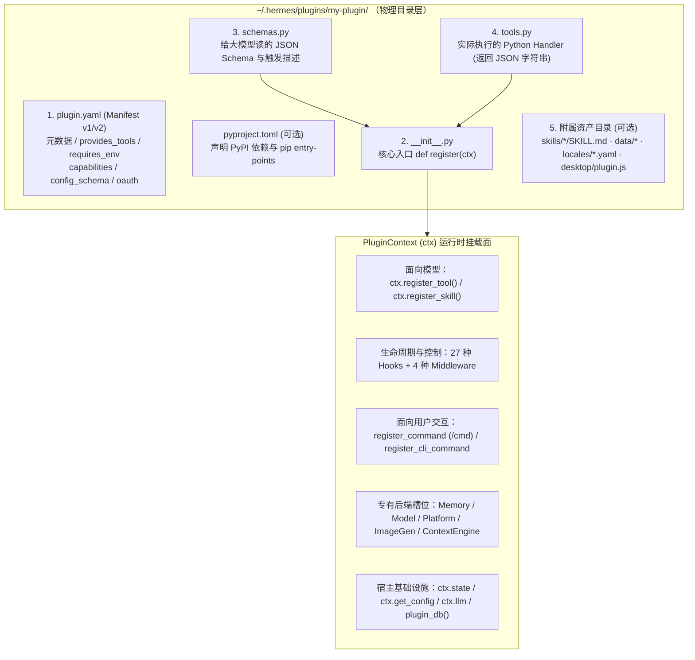

### **一个标准的 Hermes Agent 原生插件在物理上是一个存放在 `~/.hermes/plugins/<name>/` 下的轻量级 Python 包，由 `plugin.yaml` 清单、`__init__.py` 中的 `register(ctx)` 绑定入口，以及按需拆分的工具 Schema、处理器（Handler）、生命周期钩子与命名空间技能（`SKILL.md`）组成；此外 Hermes 还提供免编译 ESM 的桌面端 SDK、Web 仪表盘 SDK 与跨框架的 Portable Agent Plugins v1 格式。开发前需重点确认目标扩展平面、Manifest 权限与凭据路由契约、Gateway 单进程运行上下文约束，以及官方 Catalog 的 18 条准入红线。**

---

### **一、 补充与高价值学习资源拓展（基于你整理的 10 项清单）**

在你列出的 10 个核心站点基础上，结合 Hermes Agent 最新版本（`v0.22.x`）的仓库演进与目录拆分，有几个官方专门为插件作者剥离出来的“黄金标本库”和专项规范文档非常值得补入你的书签：

| 资源类别                                                                                                                                                                                                                     | 站点名称与直链                                                                                                                                                                                                          | 补充价值与核心看点                                                                                                                                                             |
| ---------------------------------------------------------------------------------------------------------------------------------------------------------------------------------------------------------------------------- | ----------------------------------------------------------------------------------------------------------------------------------------------------------------------------------------------------------------------- | ------------------------------------------------------------------------------------------------------------------------------------------------------------------------------ |
| 官方最小单点示例库                                                                                                                                                                                                           | [NousResearch/hermes-example-plugins](https://github.com/NousResearch/hermes-example-plugins)                                                                                                                           | 官方专门为插件作者维护的配套仓库（代码均控制在 200 行内，每个目录只演示单一扩展面：工具、`ctx.llm` 同步/异步结构化调用、脱敏 Hook、Desktop 状态栏、Dashboard 换肤）            |
| 官方实验性插件库                                                                                                                                                                                                             | [NousResearch/hermes-labs-plugins](https://github.com/NousResearch/hermes-labs-plugins)                                                                                                                                 | 官方孵化但归入 Community 层级的复杂实战插件（含 `telegram-business` 审批秘书、`workflow-record` 浏览器录制转技能、`yuanbao` 腾讯元宝网关适配器等）                             |
| 目录准入与安全红线                                                                                                                                                                                                           | [plugin-catalog 准入规范](https://github.com/NousResearch/hermes-agent/tree/main/plugin-catalog) & [上架提交指南](https://hermes-agent.nousresearch.com/docs/developer-guide/plugins/catalog-submission)                | 官方插件市场目前已突破 **2,250+ 个插件**（远超 10 月底快照的 826 个），此处定义了严格的 **18 条审核铁律**（40 位 SHA 锁死、禁热更新、凭据隔离等），与清单 #10 安全模型直接对应 |
| 桌面端与仪表盘 SDK                                                                                                                                                                                                           | [Desktop Plugin SDK](https://hermes-agent.nousresearch.com/docs/developer-guide/desktop-plugin-sdk) & [Extending the Dashboard](https://hermes-agent.nousresearch.com/docs/user-guide/features/extending-the-dashboard) | 注意 Hermes 的 UI 扩展是两套完全独立的体系：原生桌面端用 `@hermes/plugin-sdk`（免编译 ESM），Web 仪表盘用 `dashboard/manifest.json`                                            |
| 插件内调模型规范                                                                                                                                                                                                             | [Plugin LLM Access (`ctx.llm`)](https://hermes-agent.nousresearch.com/docs/developer-guide/plugin-llm-access)                                                                                                           | 插件在主对话循环之外借用宿主当前模型与凭据做单次推理、多模态分类或 JSON Schema 结构化提取的权威接口文档                                                                        |
| 中文体系化开源书                                                                                                                                                                                                             | [hermes-agent-orange-book（橙皮书）](https://github.com/alchaincyf/hermes-agent-orange-book) & [hermes-agent-guide](https://github.com/jwangkun/hermes-agent-guide)                                                     | 社区高星中文实战指南与源码解剖手册，适合配合官方英文开发文档交叉阅读                                                                                                           |
| LLM 友好的全量文档源                                                                                                                                                                                                         | [llms-full.txt](https://hermes-agent.nousresearch.com/docs/llms-full.txt)                                                                                                                                               | 官方每次部署自动生成的单文件全量文档，可直接喂给本地 Agent 或编程助手做插件 API 检索与代码生成参考                                                                             |
| [Hermes Agent](https://hermes-agent.nousresearch.com/docs/developer-guide/plugins) [GitHub](https://github.com/NousResearch/hermes-example-plugins) [Hermes Marketplace](https://hermes-agent.nousresearch.com/docs/plugins) |                                                                                                                                                                                                                         |                                                                                                                                                                                |

---

### **二、 解剖 Hermes 插件：它到底由什么组成？**

与许多把所有功能强行塞进单一插件模型的框架不同，Hermes 采用的是**“精简核心 + 多平面按需插拔（Lean core, plugins at the edges）”**的设计哲学。在研究它的组成前，首先要分清 Hermes 插件的**三大交付形态**：

1. **原生 Python 插件（Native Plugin，主力形态）**：以 `plugin.yaml` + `__init__.py`（暴露 `register(ctx)`）为核心，运行在 Gateway/Agent 进程（或独立隔离的 Plugin Host 子进程）中，掌控工具、钩子、中间件、斜杠命令以及记忆/模型/平台等底层 Provider。
2. **跨生态便携包（Portable Agent Plugins v1）**：兼容开放标准 `agent-plugins.org` 的无代码或轻代码包，由 `plugin.json` + `mcp.json`（声明 stdio 或 Streamable HTTP MCP 服务）+ `skills/*/SKILL.md` 组成。官方的 `blender`、`snyk`、`touchdesigner` 插件均采用此形态。[Hermes Agent](https://hermes-agent.nousresearch.com/docs/developer-guide/plugins)
3. **混合双端包（Unified / Hybrid Package）**：同一个插件仓库中既包含后端的 Python Agent 插件（外加可选的 `plugin_api.py` 提供 `/api/plugins/` 路由），又附带 `desktop/plugin.js`（原生桌面端 UI 扩展）或 `dashboard/manifest.json`（Web 仪表盘扩展）。
   聚焦最核心、能力最完整的**原生全功能插件**，它的内部解剖结构由以下五个模块组成：



#### **1. 清单契约层：`plugin.yaml`（支持 Manifest v2）与 `pyproject.toml`**

`plugin.yaml` 是插件的身份证与权限声明书。除了基础的 `name`、`version`、`description` 以及用于校验和展示的 `provides_tools`、`provides_hooks` 外，现代 Hermes 插件（Manifest v2）通过声明式字段直接驱动宿主的安装交互与桌面端 UI：

- **环境与密钥门禁（`requires_env` / `requires_auth` / `oauth`）**：声明 `requires_env` 后，用户执行 `hermes plugins install` 时会自动弹出交互式提示并将密钥安全存入 `.env`；若运行时缺失，插件会优雅静默停用而不会拖垮 Agent。若需第三方 OAuth（如 Google API）或复用用户的 ChatGPT/Codex 订阅登录，直接在清单声明 `oauth:` 或 `requires_auth:`，由宿主统一接管 PKCE 登录与 Token 刷新。
- **自动生成设置界面（`config_schema`）**：在清单中声明配置项的类型（`str`、`int`、`bool`、`choices` 下拉框或 `secret` 掩码输入框），**无需写一行前端代码**，Hermes Desktop 的 `Settings → Plugins` 页面就会自动渲染出可视化的插件配置表单，并与 `ctx.get_config()` 实时打通。
- **特权能力声明（`capabilities`）**：当插件需要覆盖内置工具（`tools.override`）、指定模型调用（`llm.model_override`）、发起会话分叉（`llm.session_fork`）或操作聊天平台动作（`gateway.platform_actions`）时，必须在此声明，安装和升级时会触发用户的显式授权（Consent）审计流。
- **Python 依赖管理**：通过同级目录的 `pyproject.toml`（推荐）或 `python_dependencies` 字段声明第三方库（要求锁定版本上限，如 `"httpx>=0.27,<1"`），Hermes 的包管理器（PM）会在启用插件时与核心依赖进行事务性联合解析。

#### **2. 接线中枢层：`__init__.py` 与 `register(ctx)`**

`__init__.py` 中的 `def register(ctx):` 是插件唯一的激活入口（注意默认加载超时时间为 `load_timeout_seconds: 10`，切勿在此处做耗时网络请求或重型初始化）。`ctx`（`PluginContext`）提供了二十余种注册与调用接口：

- **注册动作**：`ctx.register_tool()`（模型工具）、`ctx.register_hook()`（生命周期钩子）、`ctx.register_middleware()`（请求/执行改写中间件）、`ctx.register_command()`（会话内 `/xxx` 斜杠命令，同时兼容 CLI、TUI、Desktop 及 Telegram/Discord 机器人菜单）、`ctx.register_cli_command()`（终端 `hermes <plugin> <subcmd>` 子命令）、`ctx.register_idle_task()`（空闲后台定时任务）以及 `ctx.register_automation_blueprint()`（自动化定时任务模板）。
- **反向调用宿主能力**：`ctx.llm.complete()` / `complete_structured()`（免密钥借用宿主当前模型做旁路推理）、`ctx.dispatch_tool()`（从斜杠命令或钩子内部安全调度内置工具，自动继承审批与脱敏管线）、`ctx.call_mcp()`（调用白名单内的 MCP 工具）、`ctx.post_message()`（向当前对话发送可原地编辑更新的实时进度条消息）。

#### **3. 模型契约与执行层：`schemas.py` 与 `tools.py`**

官方推荐将工具拆分为“模型所见”与“实际运行”两半：

- **`schemas.py`**：标准的 JSON Schema 字典（含 `name`、`description`、`parameters`）。其中 `schema["description"]` 是模型决定何时调用该工具的唯一依据。
- **`tools.py`**：具体的 Python 处理函数，标准签名为 `def my_handler(args: dict, **kwargs) -> str:`。这里有三条硬性契约：**第一，必须接收 `**kwargs`**（宿主会注入 `task_id`、`session_id`、`conversation_id`、`parent_agent` 等上下文，且未来会持续扩充字段）；**第二，无论成功还是报错，返回值永远必须是序列化后的 JSON 字符串（`json.dumps(...)`）**，直接返回 `dict` 或抛出未捕获异常都是典型错误；**第三，多线程安全**，缓存客户端连接时需使用官方 `plugins.plugin_utils` 提供的 `@lazy_singleton` 或 `SingletonSlot`，避免并发子代理调用时的竞态泄漏。

#### **4. 拦截与观测层：27 个 Hooks 与 4 类 Middleware**

- **Hooks（钩子）**：分为三类——**控制指令型**（如 `pre_llm_call` 返回 `{"context": "..."}` 向当前轮次的用户消息注入记忆/RAG 上下文，或返回 `{"action": "block", "message": "..."}` 在零模型调用下直接拦截违规输入；`pre_tool_call` 返回 `block` 或 `approve` 升级人工审批）、**结果转换型**（如 `transform_tool_result`、`transform_llm_output`，配合 `hold_stream=True` 可在流式输出展示给用户前完成敏感词脱敏）以及**纯观测型**（如 `post_api_request`、`on_session_end`、`post_compaction`、`kanban_task_*`，用于 Langfuse 追踪或成本统计）。所有钩子受默认 30 秒超时保护，且异常会被捕获隔离，绝不阻断主流程（唯独 `pre_tool_call` 超时会安全关闭并阻断该工具）。
- **Middleware（中间件）**：当只读观测不够、需要真正修改入参或包裹执行过程时，使用 `ctx.register_middleware()`，支持 `tool_request`（改写工具参数，如自动给 `find` 命令追加 `| head -100`）、`llm_request`、`tool_execution`（洋葱模型包裹 `next_call`）和 `llm_execution` 四种切面。

#### **5. 状态存储、静态数据与桌面端 UI（可选资产）**

- **只读数据与捆绑技能**：随包分发的静态配置用 `Path(__file__).parent / "data"` 读取；配套的工作流提示词放入 `skills/<skill-name>/SKILL.md` 并通过 `ctx.register_skill()` 注册，模型即可通过无冲突命名空间 `skill_view("my-plugin:my-workflow")` 按需加载。
- **持久化状态存储**：**严禁往插件自身的安装目录写运行时文件**（升级或重装会被清空）。轻量级键值游标用 `ctx.state.get/set()`（每插件上限 10 MiB，原子写入、按 Profile 隔离）；大型文件或关系型数据使用 `from plugins.plugin_storage import plugin_data_dir, plugin_db` 获取专属目录 `<HERMES_HOME>/plugin-data/<name>/` 或开启 WAL 模式的线程安全 SQLite 连接。
- **Desktop 前端半边（`desktop/plugin.js`）**：若需在原生桌面应用中加侧边面板（Pane）、独立路由页、状态栏徽章或 `⌘K` 命令面板项，只需放一个免构建的原生 ESM 文件，导入 `@hermes/plugin-sdk` 与 `react/jsx-runtime`（直接用 `jsx()` 函数，不写未编译的 JSX 语法），保存即秒级热重载。

---

### **三、 我想开发一个 Hermes 插件，该怎么去研究和设计？**

在动手建目录之前，建议按照以下四步工程路径完成调研与架构设计，能帮你避开 90% 的返工：

#### **第一步：先做“是否需要写 Python 插件”的减法决策**

Hermes 提供了丰富的非代码扩展层，能用配置解决的绝不写代码：

- 如果只是想把现成的第三方工具接进来，优先看有没有现成的 **MCP Server**，或者直接封装成 **Portable Agent Plugin（`plugin.json` + `mcp.json` + `SKILL.md`）**——不仅免维护 Python 环境依赖，还能通过 `extensions."com.nousresearch.hermes"` 声明每次调用的积分成本（`costs`）、单次会话预算上限（`spend_limit`）以及非只读工具强制人工审批（`trust: untrusted`）。
- 如果只是想在工具执行后发一条桌面通知或记一行审计脚本，直接在 `config.yaml` 配置 **Shell Hooks**；如果只是接入本地命令行语音合成/识别工具（如 Kokoro、whisper.cpp），直接配置 **TTS/STT Command Templates**；如果只是教模型一套标准操作规范（SOP），写一个纯 Markdown 的 **`SKILL.md`** 即可。
- 只有当你需要**自定义有状态工具、深度拦截改写推理循环、对接专有协议网关、实现自定义记忆/上下文压缩算法，或开发原生桌面交互面板**时，才进入原生插件开发。

#### **第二步：选准插件子类别（General vs. Specialized Provider）**

明确你的插件在 Hermes 发现机制中属于哪一类，因为它们的**目录层级、基类契约与启用开关完全不同**：

- **通用插件（General Plugin）**：放在 `plugins/<name>/`，可多选并存，通过 `hermes plugins enable <name>` 加入白名单生效，适合绝大多数工具集、Hook 守卫、斜杠命令与可观测性插件。
- **专有槽位插件（Specialized Provider）**：如果你要替换某一底层引擎，必须继承对应的抽象基类（ABC）并遵循单选/路由机制——例如记忆后端继承 `MemoryProvider`（由 `config.yaml` 的 `memory.provider` 唯一激活，注意内置同名记忆插件优先级高于用户目录，务必取独一无二的名字）、上下文压缩继承 `ContextEngine`（`context.engine` 激活）、消息渠道继承 `BasePlatformAdapter`（`ctx.register_platform`）、生图后端继承 `ImageGenProvider`、电脑控制驱动继承 `ComputerUseProvider`。

#### **第三步：按“Gateway 守护进程模型”设计运行态架构**

这是新手从本地脚本思维转向 Hermes 插件开发最容易踩坑的地方：**无论是经典的 `hermes` CLI、`hermes --tui`、Hermes Desktop 还是 Telegram/Discord 机器人，所有会话的钩子、工具和斜杠命令实际上都运行在后台共享的同一个 Gateway 进程里，而不是用户敲命令的终端当前目录里！**
因此在设计代码逻辑时必须遵守四条准则：

1. **绝不使用 `os.getcwd()` 获取项目路径**：在工具或斜杠命令中定位当前会话的工作目录，必须调用 `ctx.session_cwd()` 或 `from agent.runtime_cwd import resolve_agent_cwd`。
2. **绝不使用 `print()` 或 `input()` 做交互**：斜杠命令直接 `return` 字符串作为回复；需要让用户做选择时调用 `ctx.ask_choice(question, choices)`（在 Telegram/Discord 会自动渲染成按钮卡片，在 CLI/Desktop 渲染成选择器，且在无人值守的 Cron 任务中安全返回 `None` 而不死锁）；长耗时工具用 `ctx.post_message()` / `await ctx.apost_message()` 推送实时进度。
3. **跨 Profile 隔离读取凭据与环境**：Gateway 可能同时服务多个用户 Profile，读取环境变量严禁裸读 `os.environ`，必须用 `from agent.secret_scope import get_secret`（读取密钥）或 `from gateway.session_context import get_session_env`（读取 `HERMES_SESSION_PLATFORM` 等会话级变量）。
4. **兼容进程外隔离模式（`plugins.isolation: host`）**：越来越多的安全部署会将第三方插件放到独立的 `plugin host` 子进程中通过管道与主进程通信。设计时应只依赖公开的 `ctx.*` 接口与标准序列化参数，避免依赖主进程内存引用（如私有的 `ctx._cli_ref` 在 Gateway、Kanban Worker 与单次命令模式下均为 `None`）。

#### **第四步：用官方内置诊断工具链驱动本地迭代**

在 `~/.hermes/plugins/<your-plugin>/` 下搭建骨架后，不要靠肉眼猜错，直接使用 Hermes 自带的三件套闭环验证：

- **发现链路排障**：运行 `HERMES_PLUGINS_DEBUG=1 hermes plugins list`，逐行查看插件被发现、跳过或加载失败的精确原因。
- **运行时医生检查**：运行 `hermes plugins doctor . --ci`，它会在隔离的临时 `HERMES_HOME` 中模拟真实的清单解析、命名空间导入和 `register(ctx)` 调用，自动揪出拼错的 Hook 名、漏写 `**kwargs` 的回调函数、声明与实际注册不一致的工具，甚至拦截注册期意外发起的网络 Socket 连接。
- **准入级静态与依赖校验**：运行 `hermes plugins validate /path/to/your-plugin --install-deps`，提前跑一遍与官方 Catalog CI 完全一致的安全扫描（`safe` / `caution` / `dangerous`）、核心覆盖检查与依赖冲突测试。

---

### **四、 开发前必须获取与核实的“基本要素清单”**

在正式立项写代码前，建议把以下六个维度的要素逐一核对清楚：

| 要素维度                                                                                                                                                                      | 具体需要确认或收集的内容                                               | 关键技术规范与避坑要点                                                                                                                                                                                                                                                                                                                                                                         |
| ----------------------------------------------------------------------------------------------------------------------------------------------------------------------------- | ---------------------------------------------------------------------- | ---------------------------------------------------------------------------------------------------------------------------------------------------------------------------------------------------------------------------------------------------------------------------------------------------------------------------------------------------------------------------------------------- |
| **1. 宿主版本与 Python 环境基线**                                                                                                                                             | 目标最低 Hermes 版本（`requires_hermes`）、Python 版本与第三方依赖范围 | Hermes 核心首方运行时目前已演进至 Python 3.14，插件最低兼容基线通常声明 `requires-python = ">=3.11"`；`requires_hermes` 必须填 SemVer（如 `">=0.21.5"`，禁填日期格式）；第三方 PyPI 依赖务必同时写上下界（如 `>=1.2,<2.0`），避免与宿主锁死的核心包版本冲突                                                                                                                                    |
| **2. 公开导入路径白名单（禁触私有模块）**                                                                                                                                     | 插件需要复用的宿主安全辅助函数与配置读取接口                           | 2026 年 9 月核心模块拆分后，私有路径导入会直接报 `ImportError` 且被 `validate` 拦截。务必使用受兼容性契约保护的公开接口：路径读写安全校验用 `from agent.file_safety import get_read_block_error, get_write_denied_error`；YAML 解析用 `from hermes_yaml import safe_load`（宿主不自带 PyYAML）；防重定向泄露凭据请求用 `open_credentialed_url`；文本脱敏用 `ctx.redact_text(text, force=True)` |
| **3. 精确的扩展契约签名**                                                                                                                                                     | 所选工具名、Toolset 名称、Hook 事件名及其入参/返回值结构               | 对照 `hermes_cli.plugins.VALID_HOOKS`（27 个事件）与 `VALID_MIDDLEWARE`（4 类切面）确认拼写；`pre_llm_call` 注入的上下文默认超过 `10,000` 字符会自动落盘到 `hook_outputs/` 并替换为首尾预览，避免撑爆 Prompt Cache；覆盖内置同名工具必须同时满足 `override=True` 与 `capabilities: [tools.override]`                                                                                           |
| **4. 凭据、OAuth 与配置存储方案**                                                                                                                                             | 所需外部 API Key 列表、OAuth 端点及用户可调参数表                      | 严禁读取 `.env`、`~/.hermes/auth.json` 或外部 CLI 登录文件（违反 Catalog 第 11 条直接拒收）；API Key 统一走 `requires_env` 或 `config_schema` 的 `secret` 类型配合 `get_secret()`；用户配置走 `ctx.get_config()`，运行时状态走 `ctx.state` 或 `plugin_db()`                                                                                                                                    |
| **5. 热加载边界与生效时机**                                                                                                                                                   | 哪些能力在运行中即时生效，哪些需要新会话生效                           | 在 Gateway 运行期动态启用或升级插件时，斜杠命令（`gateway_commands`）、平台原生事件回调、MCP 服务与技能可即时生效；但 Python 注册的模型工具（`tools`）和系统提示词段落属于会话快照的一部分，需在新开会话（或触发压缩/刷新）后才对模型可见                                                                                                                                                      |
| **6. 官方 Catalog 上架合规要素（如需公开发布）**                                                                                                                              | 公开 Git 仓库地址、精确的 40 位 Commit SHA、风险披露说明（Disclosure） | 若计划提交 PR 到 `hermes-agent/plugin-catalog/<name>.yaml`：代码中**严禁包含任何自更新/远程拉取脚本**（Catalog 信任模型完全建立在人工审核过的固定 40 位 SHA 上）；严禁包含编译好的二进制文件、`.pyc` 字节码或运行时 Monkey-patch 核心类（如修改 `AIAgent` 属性）；所有外发网络请求、Shell 调用与计费行为必须在 README 中如实披露                                                               |
| [Hermes Agent](https://hermes-agent.nousresearch.com/docs/user-guide/features/plugin-catalog) [GitHub](https://github.com/NousResearch/hermes-agent/tree/main/plugin-catalog) |                                                                        |                                                                                                                                                                                                                                                                                                                                                                                                |

---

### **五、 标准原生插件最小完整骨架（可直接复制起手）**

下面是一套符合最新 Manifest v2 规范、集成配置表单、持久化状态、生命周期钩子与安全工具契约的四文件起手模板：
**1. `plugin.yaml`（Manifest v2 清单）**

```yaml
name: repo-pulse
version: 0.1.0
manifest_version: 2
api_version: 1
requires_hermes: ">=0.21.5"
license: MIT
description: Query repository pulse metrics and append turn audit notes
tags: [tools, devtools]
provides_tools:
 - repo_pulse_check
provides_hooks:
 - pre_llm_call
requires_env:
 - name: PULSE_API_TOKEN
 description: "API token for the Pulse service"
 url: "https://example.com/settings/tokens"
 secret: true
config_schema:
 endpoint:
 type: str
 default: "https://api.example.com/v1"
 label: "Service Endpoint"
 description: "Base URL for pulse queries"
 inject_reminder:
 type: bool
 default: false
 label: "Inject Turn Reminder"
```

**2. `schemas.py`（模型可见的 JSON Schema）**

```python
"""Tool schemas exposed to the LLM."""
REPO_PULSE_CHECK = {
 "name": "repo_pulse_check",
 "description": (
 "Fetch health and open-issue metrics for a given Git repository slug "
 "(e.g., 'NousResearch/hermes-agent'). Use when the user asks about "
 "project activity or maintenance status."
 ),
 "parameters": {
 "type": "object",
 "properties": {
 "repo": {
 "type": "string",
 "description": "Repository in 'owner/name' format",
 },
 },
 "required": ["repo"],
 },
}
```

**3. `tools.py`（符合契约的处理器实现）**

```python
"""Tool execution handlers."""
import json
import urllib.request
from agent.secret_scope import get_secret
from hermes_cli.urllib_security import open_credentialed_url
def check_pulse(args: dict, *, endpoint: str, **kwargs) -> str:
 del kwargs # Forward-compatible for session_id, task_id, etc.
 repo = (args.get("repo") or "").strip()
 if "/" not in repo:
 return json.dumps({"ok": False, "error": "Expected 'owner/name' format"})
 token = get_secret("PULSE_API_TOKEN")
 if not token:
 return json.dumps({"ok": False, "error": "PULSE_API_TOKEN is not configured"})
 try:
 req = urllib.request.Request(
 f"{endpoint.rstrip('/')}/repos/{repo}",
 headers={"Authorization": f"Bearer {token}"},
 )
 with open_credentialed_url(req, timeout=10) as resp:
 data = json.loads(resp.read().decode("utf-8"))
 return json.dumps({"ok": True, "repo": repo, "metrics": data})
 except Exception as exc:
 return json.dumps({"ok": False, "repo": repo, "error": str(exc)})
```

**4. `__init__.py`（`register(ctx)` 绑定入口）**

```python
"""Plugin entry point."""
from pathlib import Path
from . import schemas, tools
def register(ctx):
 # 1. 注册给模型调用的工具（通过闭包读取当前插件配置与持久化计数）
 def _handle_pulse(args: dict, **kwargs) -> str:
 count = ctx.state.get("call_count", default=0) + 1
 ctx.state.set("call_count", count)
 endpoint = ctx.get_config("endpoint", default="https://api.example.com/v1")
 return tools.check_pulse(args, endpoint=endpoint, **kwargs)
 ctx.register_tool(
 name="repo_pulse_check",
 toolset="repo_pulse",
 schema=schemas.REPO_PULSE_CHECK,
 handler=_handle_pulse,
 )
 # 2. 注册会话内斜杠命令 /pulse-stats（零 Token 查看本地状态）
 def _handle_stats(raw_args: str, *, platform: str = "", **kwargs) -> str:
 del raw_args, kwargs
 total = ctx.state.get("call_count", default=0)
 return f"Repo Pulse called {total} time(s) (surface: {platform or 'local'})."
 ctx.register_command(
 "pulse-stats",
 handler=_handle_stats,
 description="Show how many times repo_pulse_check was invoked",
 )
 # 3. 注册 pre_llm_call 钩子（按开关向当前轮次注入提示）
 def _on_pre_llm(**kwargs):
 del kwargs
 if ctx.get_config("inject_reminder", default=False):
 return {"context": "Note: Prefer calling repo_pulse_check before estimating repo health."}
 return None
 ctx.register_hook("pre_llm_call", _on_pre_llm)
 # 4. 自动挂载捆绑的命名空间技能（若存在 skills/*/SKILL.md）
 skills_dir = Path(__file__).parent / "skills"
 if skills_dir.is_dir():
 for child in sorted(skills_dir.iterdir()):
 skill_md = child / "SKILL.md"
 if child.is_dir() and skill_md.exists():
 ctx.register_skill(child.name, skill_md)
```

将这组文件放入 `~/.hermes/plugins/repo-pulse/`，依次执行 `hermes plugins doctor . --ci` 与 `hermes plugins enable repo-pulse`，即可在对话和桌面端设置页中跑通完整的开发验证闭环。如果你已经有具体的插件点子或想针对某个特定子系统（如记忆后端、Desktop 面板或平台网关）深挖，我们可以直接聚焦对应接口继续展开。
