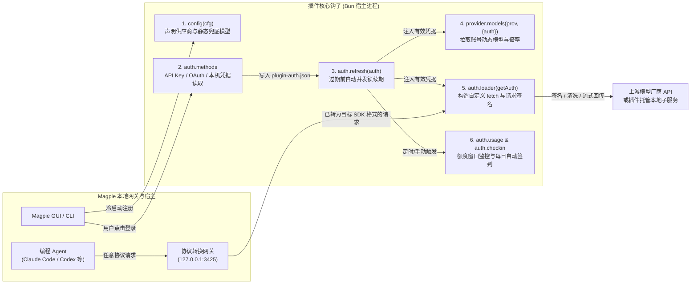

### **Magpie 插件本质上是以 `package.json` 为声明清单、运行在 Bun 进程或内置轻量级 JS 引擎 `moejs` 上的模块化扩展，主要围绕供应商接入（基于 OpenCode v1 插件规范）、网关流量拦截、Agent 配置文件桥接、MCP 工具扩展以及沙箱页面五大形态构建；开发前需根据插件定位，重点获取并梳理目标渠道的认证续期协议、推理接口与协议类型、模型目录元数据以及额度或签到接口等核心要素。**

结合官方快速上手文档、插件开发规范、`magpie-community/plugins` 社区仓库，以及你提供的 `scnet-client-auth`（轻量级客户端复用型）和 `magpie-our-free-model`（重型本地服务托管型）两个实战仓库，下面从插件的底层组成、研究路径、架构设计和要素拆解四个维度展开说明。 [magpie 文档](https://usemagpie.ai/docs/zh/start) [GitHub](https://github.com/yetone/magpie)

---

### **一、Magpie 插件的生态全景与核心组成**

Magpie 本身是一个监听在 `127.0.0.1:3425` 的 Go 语言本地网关，负责把各种编程 Agent（Claude Code、Codex、Gemini CLI、OpenCode 等）的配置指向自身，并在 OpenAI Chat Completions、OpenAI Responses、Anthropic Messages 和 Gemini 四种协议之间双向转换。插件在其中的职责，是在不改动 Magpie 核心二进制的前提下，扩展它的**上游模型来源、网关流量控制、下游 Agent 接入、全局工具或图形界面**。 [插件开发 · magpie 文档](https://usemagpie.ai/docs/zh/plugins)

#### **1. 七种插件形态与两套运行时环境**

在动手之前，首先要明确“Magpie 插件”并非单一概念。为了兼顾流式转发的微秒级低延迟与复杂异步逻辑的灵活性，Magpie 设计了**两套完全不同的运行时**，承载了七种扩展能力：

| 插件类型                            | 核心作用                                                                            | 运行时环境                                                                     | `package.json` 声明入口                                           | 典型代表                                                 |
|:----------------------------------- |:----------------------------------------------------------------------------------- |:------------------------------------------------------------------------------ |:----------------------------------------------------------------- |:-------------------------------------------------------- |
| **供应商插件 (Provider)**           | 登录订阅或第三方服务、发现模型、转发推理请求、查询额度与每日签到                    | **Bun 宿主进程**（兼容 OpenCode v1 与 `pi` 扩展包）                            | `"main": "./index.mjs"` 或 `exports["./server"]`                  | `scnet-client-auth`、`magpie-our-free-model`、`codearts` |
| **网关中间件 (Middleware)**         | 在路由前后同步改写请求体、拦截敏感词、清洗流式 SSE 事件（如剥离思考标签）           | **网关内置 `moejs`**（Go 实现的 JS 引擎，无网络/Node API，微秒级耗时）         | `"magpie": { "middleware": "./x.middleware.js" }`                 | `param-override`、`model-map`、`think-tags`              |
| **路由策略与用量 (`gateway`)**      | 自定义多账号/多模型的座位排序算法（20ms 预算），或异步消费每次请求的用量记录        | **网关内置 `moejs`**                                                           | `"magpie": { "gateway": "./x.gateway.js" }`                       | `reserve`（按额度水位线排号）                            |
| **异步网关钩子 (Gateway Hooks)**    | 在请求路由前执行外部异步 I/O（如跨会话记忆召回），在回复完成后归档对话或发通知      | **Bun 宿主进程**（可使用 `fetch` 与 Node 内置模块，默认 1s 超时）              | `"magpie": { "hooks": "./x.hooks.mjs" }`                          | `powercontext`、`nowledge-mem`、`notify`                 |
| **全局工具与搜索 (Tools / Search)** | 通过内置 `/mcp/magpie/tools` 向所有 Agent 暴露 MCP 工具，或向设置页注册联网搜索引擎 | **Bun 宿主进程**                                                               | `"main": "./index.mjs"`（导出 `tool` 或 `search` 钩子）           | `calc`、`search1api`、`magpie-websearch`                 |
| **Agent 接入插件 (Agent)**          | 声明非内置 Agent 的配置文件路径、格式与字段映射，实现一键接入网关与无损还原         | **网关内置 `moejs`**（复杂场景可搭配 `main` 跑 Bun 守护）                      | `"magpie": { "agent": "./x.agent.js" }`                           | `aider`、`kilo`、`opencodereview`                        |
| **窗口页面 (Page)**                 | 在 Magpie 桌面端或 Web UI 侧边栏嵌入自定义面板，查看统计或修改插件专属配置          | **前端沙盒 `iframe`**（`connect-src 'none'`，仅通过 `_magpie/bridge.js` 通信） | `"magpie": { "page": { "title", "file" }, "permissions": [...] }` | `usage`、`agent-office`、`chat`                          |

一个 NPM 包或仓库既可以只承担其中一种角色（例如纯中间件不写 `main`，从而不启动 Bun 进程），也可以组合多种声明（例如同时提供 `page` 配置面板与 `hooks` 记忆召回）。

#### **2. 标准包文件组成与宿主存储机制**

从工程目录上看，一个最常见的**供应商插件（Provider Plugin）**由以下核心部分组成：

1. **清单文件 `package.json`**：使用 ES Module（`"type": "module"`），通过 `main` 或 `exports` 指向入口（支持直接指向 `.ts` 文件，Bun 原生解析，**注意 Magpie 安装插件时用 `bun add` 且禁用 `postinstall` 脚本，因此切勿依赖安装期编译**）。其中的 `"magpie"` 字段是专为宿主提供的扩展元数据（OpenCode 会安全忽略），包含：
   - `icon`：`https://` 图片链接或 `data:image/...` Base64 URI（上限 1 MB，支持 SVG/PNG/WebP 等），用于插件卡片和供应商列表展示。 [GitHub](https://github.com/yetone/magpie/blob/main/docs/reference.md)
   - `name`：单行最多 80 字节的展示名称（解决 npm 包名只能用 ASCII 字符而无法展示中文品牌名的问题）。
   - `maxConcurrency`：单账号最大并发请求数（1–1000），保护上游免受并发封禁。
   - `options`：给用户的默认 JSON 配置模板。
   - `uninstall`（新特性，如 `magpie-our-free-model` 所用）：卸载清理脚本路径，用于回收插件在外部拉起的进程或下载的运行时缓存。 [GitHub](https://github.com/mu-zi-lee/magpie-our-free-model/blob/main/package.json)
2. **入口模块 `index.mjs` / `index.ts`**：必须遵循导出约定——要么 `export default { id, server }`，要么导出一个或多个 `async function MyPlugin(input, options)`。**切记不要在入口文件直接 `export` 普通辅助函数**，因为宿主会把入口导出的每一个函数都当作独立插件去调用（需要暴露给单测的内部函数应统一挂载在 `export const _internal = { ... }` 对象上）。
3. **宿主侧状态与持久化文件**：插件自身通常不需要自己写凭据加密存储逻辑。Magpie 会在 `~/.config/magpie/`（或 `$XDG_CONFIG_HOME/magpie`）下统一维护四个关键文件：
   - `plugins.json`：记录已安装的插件路径/包名、启停状态以及传入插件第二参数的 `options`。
   - `plugin-auth.json`：权限为 `0600` 的账号凭据库，与 OpenCode 的 `auth.json` 结构完全一致，多账号自动以 `providerId` 和 `providerId#xxxxxx` 区分。
   - `plugin-providers.json`：缓存插件最近一次上报的供应商与模型列表，确保 Magpie 冷启动时无需等待插件联网查询即可秒开。
   - `plugins/`：独立的 Bun 工作区目录，存放从 npm 或 Git 拉取的代码包。

#### **3. 供应商插件的生命周期钩子（Hooks 契约）**

当你的入口函数被 Bun 宿主调用时，会收到 `(input, options)` 两个参数（`input` 内含 `client.auth.set/remove`、`client.app.log`、配置目录 `directory` 和 Bun Shell `$`），并返回一组决定供应商全生命周期的钩子对象：



这六个核心钩子分工极为清晰：

- **`config(config)`**：在未登录任何账号前运行，声明供应商名称、底层协议包（`npm` 字段，如 `@ai-sdk/openai-compatible`、`@ai-sdk/anthropic`、`@ai-sdk/openai`、`@ai-sdk/google`）以及静态兜底模型表。Magpie 会根据你声明的 `npm` 类型，自动把下游 Agent 发来的请求提前翻译成对应的报文格式再交给你的插件。
- **`auth.methods`**：定义登录交互方式。支持 `"api"`（直接填 Key，或经 `authorize(inputs)` 校验换取 Key）和 `"oauth"`（支持 `prompts` 表单前置提问，`method: "auto"` 自动轮询/本地回调，或 `method: "code"` 让用户粘贴验证码/授权码）。
- **`auth.refresh(auth)`**：Magpie 专属钩子。当 OAuth 凭据距离 `expires` 小于 `refreshLead`（默认 5 分钟）时，宿主在发起模型查询、推理或额度检查前自动调用，且**对同一账号加并发锁（只续期一次）**，完美适配一次性 Refresh Token 轮换机制。
- **`provider.models(provider, { auth })`**：按账号作用域运行，动态拉取该账号有权访问的模型列表、上下文窗口、多模态支持、思考档位（`variants`）及计费倍率（`rate` / `free`）。
- **`auth.loader(getAuth, provider)`**：返回 `{ baseURL, apiKey, headers, fetch }`。其中的自定义 `fetch(input, init)` 是插件最核心的数据面枢纽，负责最终的 URL 校验、动态签名（如 HMAC）、请求体微调、错误码改写和 SSE 流透传。
- **`auth.usage` 与 `auth.checkin`**：均为 Magpie 扩展钩子。`usage` 返回套餐名称、剩余百分比、重置时间 `resetsAt` 等额度窗口（直接驱动 Magpie 的 `smart` / `pace` 智能路由算法！）；`checkin` 则在每个北京时间自然日自动替账号执行“每日签到领积分”。

---

### **二、从三个真实标杆仓库拆解插件的设计模式**

你给出的几个链接恰好代表了 Magpie 插件从“轻量直连”到“复杂协议逆向”再到“重型子服务托管”的三种典型架构范式。吃透它们的差异，能帮你迅速定位自己的插件该怎么写：

#### **1. 轻量客户端凭据复用模式：`Vist233/scnet-client-auth`**

这个仓库非常精炼（仅 `index.mjs`、`credentials.mjs`、`login.mjs`、`models.mjs` 四个源码文件），目标是把超算互联网桌面客户端（`计算服务.exe`）接入 Magpie。 [GitHub](https://github.com/Vist233/scnet-client-auth)

- **核心设计亮点**：它巧妙利用了 `auth.methods` 的组合能力，一口气提供了四种登录路径——① `autoMethod`（用 `type: "oauth"` + 空 `url` + `method: "auto"` 的技巧，免浏览器直接扫描本机 `%USERPROFILE%\.sclaw\agent\scnet-credentials` 或 WSL 挂载目录提取桌面端已登录的 `sk-` Key）；② 手动粘贴 Key；③ 带有 `prompts` 账号密码输入与图形验证码 Data URI 回退的密码登录；④ 手机号短信两步验证登录。
- **安全边界实践**：在 `loader.fetch` 中，它严格校验了请求的 `url.origin` 和 `url.pathname` 必须等于超算的 Chat Completions 端点，主动剔除了下游可能透传过来的 `cookie`、`x-api-key` 等杂项头，换上真实的 `Bearer ${key}`，并强制设置 `redirect: "error"` 防止重定向泄露凭据。同时因为该客户端接口不提供额度查询，作者干脆省略了 `auth.usage` 钩子，保持诚实与克制。

#### **2. 深度协议签名与流式整形模式：`magpie-community/plugins`（以 `codearts` 为例）**

社区官方仓库里的订阅插件多属于“无标准 API Key 的厂商 IDE 订阅适配”。 [GitHub](https://github.com/magpie-community/plugins)

- **核心设计亮点**：华为云 CodeArts 没有固定 Key，每次请求都需要临时 AK/SK/SecurityToken 做 `SDK-HMAC-SHA256` 签名。插件在 `authorize()` 中临时在 `127.0.0.1` 随机高位端口（`>=10000`）拉起单次 HTTP 回调服务，配合 PKCE 与 WebCrypto 生成的 ES256 DPoP 密钥对完成浏览器 OAuth 登录，并将整套旋转凭据序列化保存在账号记录的 `access` 字段里。
- **脏活累活的消化**：真实上游往往有很多“怪癖”，插件就是抹平怪癖的隔离层。例如上游限制函数名不超过 64 字符（MCP 工具名经常超长），插件在 `fetch` 发包前把超长工具名截断为“前 55 字符 + SHA256 短哈希”，等收到 SSE 流式响应时再实时把工具名还原回去；上游在 HTTP 200 的 SSE 首包里塞入欠费或限流错误码，插件通过 `peekAnswer` 预读流头部字节，一旦识别出业务错误码就将其改写为标准的 HTTP `429` 或 `401`（附带 `X-Magpie-Sign-In: expired` 响应头），从而让 Magpie 网关能够正常触发跨账号故障转移（Failover），而不是给用户返回一个空白气泡。

#### **3. 重型本地子服务托管模式：`mu-zi-lee/magpie-our-free-model`**

当你要整合的不是单一接口，而是一整套已有的复杂多渠道后端（原项目 `dsh-our-free-model`，含 13 个账号渠道、独立 Web 控制台和 Node Worker）时，全用单个插件钩子重写成本过高。 [GitHub](https://github.com/mu-zi-lee/magpie-our-free-model)

- **核心设计亮点**：插件本身退化为一个**生命周期管家与反向代理桥**。首次启用时，插件自动检测环境并在私有数据目录（`~/.config/magpie/our-free-model/runtime/`）按固定 SHA-256 校验下载独立 Node 运行时、原项目渠道包及 `cloudflared`（用于无桌面 SSH 服务器生成免登录临时 HTTPS 管理隧道），在回环地址 `127.0.0.1:18900` 拉起本地后端服务。
- **高级特性联动**：它在 `config` 钩子中声明了 `decide: true`，并给免费池里的 `jev-1.13-free` 模型打上决策模型标记，将 Magpie 意图路由器的 `POST /v1/systemone` 请求无缝桥接到上游分类器；同时利用 `package.json` 的 `magpie.uninstall` 钩子实现了卸载时的进程关停与运行时文件全自动清理。

---

### **三、开发一个 Magpie 插件需要获取哪些“基本要素”？**

无论你想接入某家新出的 Coding Plan 订阅、公司内部的大模型网关，还是某个桌面客户端的免费模型池，在写第一行代码前，你都需要通过阅读接口文档、分析本地客户端文件或抓包实测，收集齐以下 **5 张要素清单**：

#### **要素清单 1：插件定位与身份要素（Identity & Architecture）**

- **扩展类型选择**：你的需求是增加模型来源（写 Provider 插件）、修改全局请求参数（写 `moejs` 中间件）、接入新 CLI 工具（写 Agent 插件），还是加 MCP 工具？如果只是标准 OpenAI/Anthropic 兼容接口加固定 API Key，其实直接用 Magpie 内置的“自定义供应商”或生成一条“Add to magpie”导入链接即可，**只有存在特殊登录流、动态签名、客户端凭据复用、额度查询或每日签到时，才值得开发 Provider 插件**。
- **唯一供应商 ID（`provider id`）**：全小写字母、数字与连字符（如 `scnet-client`）。切勿与 Magpie 内置预设（`openai`、`anthropic`、`deepseek` 等）重名，否则会被强制追加 `-plugin` 后缀。
- **品牌图标与展示名**：准备一个小于 1 MB 的 SVG 或 WebP 图标（转成 `data:image/...` 内联最稳妥，无需外部联网即可渲染），以及中英文简介。

#### **要素清单 2：认证与会话生命周期要素（Auth & Session）**

- **凭据获取路径**：
  - *API Key 型*：Key 的格式前缀是什么（如 `sk-` vs `sk-tp-`）？是否需要前置输入区域（国内站/国际站）、企业域名或备注名？
  - *OAuth / 浏览器授权型*：授权页 URL、Client ID、Scope 是什么？是否要求 PKCE 或 DPoP 签名？回调地址是否允许 `http://127.0.0.1:<随机端口>/...`？如果回调端口固定或运行在远程服务器上，是否需要提供“复制回调 URL 粘贴（`method: "code"`）”的降级方案？
  - *本机客户端复用型*：目标桌面应用（Electron / VS Code 分支 / CLI）把登录态存在哪里？（例如 JSON 配置文件、操作系统的 Keychain，或是 VS Code 系的 `globalStorage/state.vscdb` SQLite 数据库——注意读取 SQLite 时务必先拷贝原文件连同 `-wal`/`-journal` 到临时目录再只读打开，绝不能锁死原客户端的数据库）。
- **账号唯一标识（`accountId` 与 `uid`）**：Magpie 支持同一个供应商登录多个账号。你必须从登录返回或用户信息接口中找到一个**跨续期稳定不变的唯一标识**（如用户 URN、Domain ID 或邮箱）填入 `accountId` / `uid`，否则用户每次重新登录或刷新 Token 都会在列表里裂变出一个重复的新账号；而用于界面友好展示的脱敏手机号或昵称应放在 `usage().user` 或 `metadata.email` 中。
- **过期与续期规则**：Access Token 有效期多久？提前多久续期最安全（`refreshLead`）？Refresh Token 是否是“用一次即作废（One-time rotation）”？哪些错误码代表“临时网络抖动稍后重试”，哪些错误码（如 `invalid_grant`）代表“彻底失效必须提示用户重新登录（抛 `{ signIn: "expired" }`）”？

#### **要素清单 3：模型目录与能力元数据要素（Model Catalog）**

- **静态兜底列表 vs 动态账号列表**：未登录时默认展示哪些主打模型？登录后是否有专门的 `/models` 或客户端本地 `models.json` 接口查询当前账号真实可用的模型？
- **精确的模型规格参数**：
  - 上下文窗口上限（`limit.context`）与最大输出 Token（`limit.output`，很多网关传大了会直接报 400 参数校验失败，必须在插件里截断保护）。
  - 输入模态能力（`capabilities.input`）：是否真正支持图片（`image: true/false`）？**不支持多模态的模型务必显式声明 `image: false`**，这样 Magpie 网关会自动替它做识图转文字或过滤图片，避免上游报错。
  - 工具调用支持（`capabilities.toolcall`）与工具名称长度限制。
  - **深度思考档位（`variants`）**：哪些模型支持推理？上游接受的 `reasoning_effort` 或 `thinking` 枚举词分别是什么（如 `low`/`medium`/`high`/`max`，以及是否允许传 `none` 或 `{ type: "disabled" }` 彻底关闭思考）？如果模型声明了推理能力但没配 `variants`，部分宿主可能把思考流直接混进正文展示。
  - 计费属性：是否为免费模型（`free: true`）？请求消耗积分倍率是多少（`rate`，如 `1.5`）？

#### **要素清单 4：推理协议与流量兼容要素（Protocol & Transport）**

- **基础协议选型**：上游原生说哪种方言？优先选择最贴近上游原生能力的 `@ai-sdk/*` 包（例如上游原生支持 Anthropic `/v1/messages` 就选 `@ai-sdk/anthropic`，普通兼容接口选 `@ai-sdk/openai-compatible`），协议转换的事交给 Magpie 网关，插件不要重复造轮子。
- **请求头与请求体特殊约束**：
  - 上游是否拒绝带 `provider/` 前缀的模型名？（需要确保发出去的是裸模型 ID）。
  - 上游是否有特殊的必传 Header（如特定的 `User-Agent`、客户端版本号、会话粘性头 `Session-Id`，或者免费池专用的 `maas_type: benefit`）？
  - `stop` 字段要求是字符串还是数组？是否只对 `stream: true` 计费或正常响应（如果是，非流式请求需要在插件里强制转流式发送再聚合折叠回 JSON）？
  - 账号最大并发限制是多少？（需同步配置 `maxConcurrency` 并在必要时内置并发信号量队列）。
- **异常语义映射**：上游在欠费、额度耗尽、并发超限、Token 过期时，返回的真实 HTTP 状态码和 JSON/SSE 报文长什么样？如果上游存在“HTTP 200 里包错误码”的反模式，必须记下全部错误码正则表达式，以便在 `fetch` 里翻译成标准的 `401`、`429`、`400` 或 `502`。

#### **要素清单 5：额度监控与每日福利要素（Quota & Check-in，可选但高价值）**

- **用量接口（供 `auth.usage` 使用）**：上游是否有查询剩余 Token、积分包或金额余额的接口？如果有，区分哪些是“主控总额度窗口”（耗尽后 Magpie 自动切走账号），哪些只是“子包明细或附赠免费池”（需标记 `aside: true`，避免附赠小包用完导致整个付费大号被误停）。同时查清额度的重置周期时间（`resetsAt`）或最早过期批次时间（`runsOutAt`）。
- **签到接口（供 `auth.checkin` 使用）**：上游是否有每日签到领积分接口？它的幂等性如何（重复签到返回什么状态码）？按北京时间零点刷新还是特定钟点（可设置 `until`）？遇到图形验证码时切勿强行破解，直接返回 `{ outcome: "captcha" }` 提示用户回官方客户端点击即可。

---

### **四、从零研究与设计开发 Magpie 插件的标准工作流**

掌握了组成与要素后，你可以按照以下五步法高效推进插件研发：

#### **第一步：逆向调研与最小闭环验证（脱离 Magpie 先跑通脚本）**

不要一上来就写插件代码。先用纯 `bun` 或 `node` 写几个独立的探测小脚本（或借助抓包工具观察官方客户端流量），把上述五大要素逐一实测摸清：跑通一次登录拿 Token、调一次模型列表接口、发一次带工具调用和思考模式的流式请求、故意触发一次限流或过期看看原始报错报文。像 `magpie-community/plugins` 中的高质量插件，都会把实测日期和上游真实报错码写在源码注释里作为依据。

#### **第二步：选定同类型脚手架模板，初始化无依赖工程**

Magpie 社区强烈推崇**零运行时第三方依赖**——Bun 与现代 Node 内置的 `fetch`、`crypto.subtle`（WebCrypto）、`node:crypto`、`node:fs`、`bun:sqlite` 已经能覆盖几乎所有加密签名与本地存储需求，零依赖能保证用户秒装且不出供应链故障。你可以直接从 `magpie-community/plugins/packages/` 中挑选结构最接近的包作为起点：

- 做免密或简单 Key 订阅：参考 `zen-free` 或你看的 `Vist233/scnet-client-auth`；
- 做复杂 OAuth + 请求签名 + 额度签到：参考 `codearts` 或 `workbuddy`；
- 做网关请求改写中间件：参考 `think-tags` 或 `model-map`；
- 做 MCP 工具或联网搜索：参考 `calc` 或 `magpie-websearch`；
- 做新 CLI Agent 配置接入：参考 `aider`。 [GitHub](https://github.com/magpie-community/plugins)

下面给出一个融合了核心最佳实践的**供应商插件最小骨架模板**（`package.json` + `index.mjs`）：

```json
{
  "name": "magpie-myvendor-auth",
  "version": "0.1.0",
  "description": "MyVendor Coding Plan provider plugin for Magpie",
  "type": "module",
  "main": "./index.mjs",
  "files": ["index.mjs", "README.md", "LICENSE"],
  "keywords": ["opencode", "opencode-plugin", "magpie-plugin", "myvendor"],
  "license": "MIT",
  "magpie": {
    "name": "我的厂商 MyVendor",
    "icon": "data:image/svg+xml;base64,...",
    "maxConcurrency": 4
  }
}
```

```javascript
// index.mjs — 遵循 OpenCode v1 异步插件函数规范，切勿导出多余辅助函数
const PROVIDER_ID = "myvendor"
const BASE_URL = "https://api.myvendor.example/v1"
const NPM_SDK = "@ai-sdk/openai-compatible"

export async function MyVendorPlugin({ client }, options = {}) {
  return {
    // 1. 冷启动声明供应商与静态兜底模型（使用 ??= 尊重用户自定义覆盖）
    async config(config) {
      config.provider ??= {}
      config.provider[PROVIDER_ID] ??= {
        name: "MyVendor",
        npm: NPM_SDK,
        api: BASE_URL,
        models: {
          "my-coder-pro": {
            name: "My Coder Pro",
            limit: { context: 128000, output: 16384 },
            capabilities: {
              reasoning: true,
              toolcall: true,
              input: { text: true, image: false },
              output: { text: true },
            },
            variants: {
              low: { reasoningEffort: "low" },
              high: { reasoningEffort: "high" },
            },
          },
        },
      }
    },

    // 2. 按账号动态刷新模型列表（网络失败时返回 provider.models 保留缓存）
    provider: {
      id: PROVIDER_ID,
      async models(provider, { auth } = {}) {
        if (!auth) return provider.models
        try {
          // 可在此使用 auth 凭据请求上游模型目录并映射字段
          return provider.models
        } catch {
          return provider.models
        }
      },
    },

    // 3. 认证、续期、请求转发与额度监控
    auth: {
      provider: PROVIDER_ID,
      refreshLead: 5 * 60 * 1000,
      methods: [
        {
          type: "api",
          label: "MyVendor API Key",
          placeholder: "mv-...",
        },
      ],
      async loader(getAuth) {
        return {
          baseURL: BASE_URL,
          async fetch(input, init = {}) {
            const auth = await getAuth()
            const req = new Request(input, init)
            const url = new URL(req.url)

            // 安全围栏：仅向可信上游域名发送凭据，禁止重定向携带鉴权头
            if (url.origin !== new URL(BASE_URL).origin) {
              throw new Error(`Refusing request to untrusted host: ${url.origin}`)
            }

            const headers = new Headers(req.headers)
            headers.set("authorization", `Bearer ${auth.key}`)
            headers.set("x-client", "magpie-myvendor-auth/0.1.0")

            const res = await fetch(url, {
              method: req.method,
              headers,
              body: req.body,
              signal: req.signal,
              redirect: "error",
            })

            // 若上游用特定 403 表示密钥彻底失效，附加 X-Magpie-Sign-In 告知宿主停用该号并切换
            if (res.status === 401) {
              const h = new Headers(res.headers)
              h.set("X-Magpie-Sign-In", "expired")
              return new Response(res.body, { status: res.status, headers: h })
            }
            return res
          },
        }
      },
      async usage(getAuth) {
        const auth = await getAuth()
        if (!auth?.key) return { error: "未登录", windows: [] }
        // 调用上游额度接口并映射为百分比窗口
        return {
          plan: "Pro Plan",
          signIn: "kept",
          windows: [
            { name: "5 小时窗口", used: 25, display: "250 / 1000", resetsAt: new Date(Date.now() + 3600_000).toISOString() },
          ],
        }
      },
    },
  }
}

// 供本地单元测试导入，宿主不会将其当作插件执行
export const _internal = { PROVIDER_ID, BASE_URL }
```

#### **第三步：在隔离沙箱（Sandbox HOME）中联调与排错**

正在开发的插件**绝不要直接装进你日常办公使用的 Magpie 主环境**，以免弄乱真实的 `providers.json` 或 Agent 配置。标准做法是指定一个独立的临时 `HOME` 和 `XDG_CONFIG_HOME` 目录进行就地加载测试：

```bash
# 1. 创建隔离沙箱封装函数，不影响真实环境与已连接 Agent
mkdir -p .sandbox/home .sandbox/config
mp() {
  HOME="$PWD/.sandbox/home" XDG_CONFIG_HOME="$PWD/.sandbox/config" magpie "$@"
}

# 2. 就地挂载当前文件夹插件（无需打包发布，修改源码后开关一次插件或重跑 CLI 即生效）
mp plugin add "$PWD"

# 3. 逐项验收登录流、模型发现、推理连通性与额度钩子
mp plugin login myvendor
mp models | grep myvendor
mp provider test myvendor
mp quota

# 4. 实时跟踪宿主日志（所有 console.log 与钩子报错都会以 plugin: 前缀写入此处）
mp log -f
```

同时建议像 `magpie-our-free-model` 和 `scnet-client-auth` 那样，在 `tests/` 目录下利用 `node:test` 或 `bun test` 搭配本地 `127.0.0.1` 模拟 HTTP Server（Stub）编写单元测试，重点覆盖：流式回复与工具调用还原、上游报错状态码转换、取消信号（`AbortSignal`）透传、Token 并发续期去重以及无网络时的模型缓存回退。

#### **第四步：遵循安全与健壮性红线**

在打磨细节时，有几条社区踩坑总结出的铁律值得逐项核对：

1. **凭据防泄漏围栏**：在 `loader.fetch` 中必须校验目标 `URL` 的域名白名单（防止用户在配置中覆盖 `api` 地址导致你的插件把高权限 Token 签发给恶意地址），且所有带鉴权头的 `fetch` 一律加上 `redirect: "error"`，绝不在日志或报错文案里打印明文 Key、密码或完整手机号。
2. **多账号状态严格隔离**：如果插件需要在内存中维护缓存、并发锁或会话 ID，Map 的键必须是具体的账号身份或 Token 指纹，**绝不能用全局单一变量按供应商维度混存**，否则用户登录两个账号时会发生串号或互相踢下线。
3. **修改流式响应必删长度头**：一旦你在 `fetch` 里拦截、预读或改写了响应正文（如折叠流、替换工具名），重新构造 `Response` 时必须删掉原响应头中的 `content-length` 和 `content-encoding`，否则网关或下游客户端会因字节数不匹配而截断报错。

#### **第五步：分发、上架与社区曝光**

测试通过后，你有三种循序渐进的分发渠道：

1. **GitHub 直装与自动发现**：将代码（确保入口文件已提交在仓库内，不依赖发布时构建 `dist`）推送到 GitHub，并在仓库 Topics 中打上 `magpie-plugin` 标签。约十分钟内，全球所有 Magpie 用户的“插件 → 发现 → 非官方插件 · GitHub”列表就会自动抓到你的仓库并展示图标，用户可直接通过 `magpie plugin add github:你的用户名/仓库名` 安装。 [Writing plugins · magpie docs](https://usemagpie.ai/docs/plugins)
2. **发布至 npm**：在 `package.json` 的 `keywords` 中包含 `["opencode", "opencode-plugin", "<厂商名>"]`，发布后即可在 Magpie 插件搜索框中被直接检索安装，并支持新版本小圆点更新提示。
3. **合入官方精选市场**：若插件通用性强且无多余依赖，可向 `magpie-community/plugins` 提交 PR（将包放入 `packages/` 或在 `registry.json` 中补充中英文 `summary` 与 `providers` 条目）。需要注意官方仓库按“上游服务渠道（Channel）”去重——如果该厂商已有插件收录，你需要在 PR、README 和简介中明确说明你的插件在登录方式、调用端点或能力上与现有插件的具体差异（正如 `scnet-client-auth` 在文档开头专门声明它对接的是“计算服务桌面端 `sk-` Key”，而非已有的“Token Plan `sk-tp-` Key”一样）。

如果你接下来已经有了明确想对接的目标平台或打算编写的具体插件类型（比如某个特定厂商的订阅、网关中间件还是自定义页面），我们可以直接针对它的接口特征设计具体的钩子实现方案。
