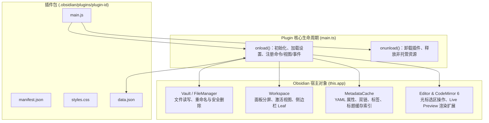

### **Obsidian 插件本质上是一个基于 TypeScript 编译的 CommonJS 模块包，由运行时核心文件（`manifest.json`、`main.js`、可选的 `styles.css` 与 `data.json`）以及与宿主环境交互的 `Plugin` 生命周期类构成；开发一款插件需要依次完成赛道与交互研究、跨端与 API 边界设计，并备齐清单元数据、工程工具链、核心 API 映射及合规审核要素。**

结合你整理的全链路资源矩阵与官方最新规范，下面从**插件的底层解剖结构**、**研究与架构设计方法论**、**开发必备基础要素清单**三个维度，为你系统拆解如何从零调研、设计并落地一款高质量的 Obsidian 插件。

---

### **一、Obsidian 插件是由什么组成的？**

理解 Obsidian 插件的组成，需要将其拆分为**运行时产物**（用户安装到库里的文件）、**工程源码结构**（开发者编写和维护的仓库）以及**软件运行架构**（代码如何在宿主内工作）三个层面。

#### **1. 运行时产物层（用户 Vault 中的真实形态）**

当用户在 Obsidian 中安装并启用一个插件时，Obsidian 实际上是在当前库（Vault）的 `.obsidian/plugins/<your-plugin-id>/` 目录下读取并加载以下四个核心文件：

* **`manifest.json`（身份与元数据清单，必需）**：JSON 格式的描述文件，定义了插件的唯一 `id`、显示名称 `name`、版本号 `version`、最低兼容宿主版本 `minAppVersion` 以及是否仅限桌面端 `isDesktopOnly`。Obsidian 启动时首先扫描此文件以决定是否加载插件。 [Developer Documentation](https://docs.obsidian.md/Reference/Manifest)
* **`main.js`（编译后的逻辑入口，必需）**：整个插件唯一被宿主执行的 JavaScript 文件。无论开发时拆分成多少个 TypeScript 模块或引入了多少第三方 NPM 库（如日期处理库或 UI 框架），最终都必须通过打包器（如 esbuild）编译并打包成这一个 CommonJS 格式的单文件，且默认导出一个继承自 `Plugin` 的类。 [npm](https://www.npmjs.com/package/obsidian)
* **`styles.css`（界面样式表，可选）**：插件的全局样式文件。插件启用时，Obsidian 会自动将其注入 DOM；插件禁用时自动移除。最佳实践是大量复用 Obsidian 原生提供的 CSS 变量（如 `--background-primary`、`--text-normal`、`--interactive-accent`），从而自动适配用户的亮暗色模式与第三方主题。
* **`data.json`（本地持久化配置与状态，运行时自动生成）**：当插件调用 `this.saveData()` 时，Obsidian 会在该插件文件夹下生成此文件，用于保存用户的设置项（Settings）或插件的轻量级本地缓存数据。

#### **2. 开发与发布工程层（GitHub 仓库的完整组成）**

在开发阶段，官方模板仓库 `obsidian-sample-plugin` 构成了标准工程骨架。除了上述源码外，一个面向社区发布的标准仓库还包含以下关键工程组件： [GitHub](https://github.com/obsidianmd/obsidian-sample-plugin)

* **源码与类型系统**：`src/` 目录（包含入口 `main.ts`、设置页 `settings.ts` 等业务模块）、`tsconfig.json` 以及核心依赖包 `obsidian`（本质上是完整的 TypeScript 类型声明文件 `obsidian.d.ts`，提供 API 补全与文档注释，不包含闭源运行代码）。
* **构建与版本脚本**：`esbuild.config.mjs` 负责极速热编译（开发模式下监听文件修改并实时输出 `main.js`）；`version-bump.mjs` 与 `versions.json` 配合使用，用于记录“插件各历史版本对应的最低 Obsidian 版本”，保障老版本客户端用户仍能下载到兼容的旧版插件。
* **质量与开源合规文件**：`eslint.config.mjs`（接入官方 `eslint-plugin-obsidianmd` 进行静态合规扫描）、`README.md`（将在官方插件市场详情页直接渲染展示）以及 `LICENSE`（开源协议文件，上架必填）。 [GitHub](https://github.com/obsidianmd/eslint-plugin) [Developer Documentation](https://docs.obsidian.md/Plugins/Releasing/Submit+your+plugin)

#### **3. 运行时软件架构层（宿主交互核心）**

在代码内部，插件运行在 Obsidian 的宿主上下文中（桌面端基于 Electron，移动端基于 Capacitor WebView），其内部结构围绕**生命周期控制**与**核心子系统调用**展开：

插件通过继承 `Plugin` 基类，在 `onload()` 方法中挂载功能，并通过实例属性 `this.app` 访问宿主的四大核心模块：**`Vault` 与 `FileManager`**（处理底层 Markdown 文件增删改查并自动维护双链更新）、**`Workspace`**（控制工作区标签页、弹窗 Modal、侧边栏自定义视图 `ItemView`）、**`MetadataCache`**（无需每次正则解析全文，直接以极高性能读取笔记的 Frontmatter 属性、标签与双向链接图谱），以及 **`Editor`**（与底层 CodeMirror 6 编辑器交互，处理文本替换或实时预览装饰器）。 [Developer Documentation](https://docs.obsidian.md/Plugins/Getting+started/Anatomy+of+a+plugin)

---

### **二、如何去研究和设计一个 Obsidian 插件？**

有了你整理的那份高质量导航列表，完全可以按照“**市场验证 → 竞品源码拆解 → 原生契合度设计 → 原型闭环验证**”的四步法推进，避免闭门造车或因违反架构规范而在后期返工。

#### **第一步：需求验证与生态空白挖掘（利用榜单与社区资源）**

动工写代码前，先确认“你要做的东西是否已经被原生功能覆盖，或者已有成熟插件解决”：

1. **排查官方演进路线**：查阅 `obsidian.md/changelog`（版本更新日志）。Obsidian 官方近年来不断将高频刚需“转正”为内置核心功能（例如 Properties 文档属性、Canvas 白板、Web Viewer 网页浏览以及 Bases 数据库视图等）。确保你的核心切入点不会被即将或已经上线的原生功能直接替代。
2. **检索存量市场与趋势数据**：在 `obsidian.md/plugins` 与 `pkmer.cn` 搜索同类关键词，结合 `obsidianstats.com` 观察同类插件的下载增速、最近更新时间（判断老牌插件是否已弃坑断更）。如果某个赛道下载量极高，但其 GitHub Issues 中积压了大量关于性能卡顿、不支持移动端或 UI 老旧的抱怨，这就是极佳的切入机会。
3. **收集真实痛点场景**：前往 `forum.obsidian.md`（重点看 *Plugin ideas* 与 *Share & showcase* 板块）、`forum-zh.obsidian.md` 以及 `r/ObsidianMD`，看重度用户正在用什么笨办法（比如复杂的 Templater 脚本拼凑）解决某个问题。将这些繁琐脚本产品化、图形化，往往能诞生精品插件。

#### **第二步：标杆插件源码拆解（最高效的技术调研捷径）**

由于所有上架 Obsidian 社区市场的插件都必须在 GitHub 开源，整个插件市场就是你的代码参考库：

1. 通过 `obsidianmd/obsidian-releases` 仓库中的 `community-plugins.json`，你可以直接检索任意同类优秀插件对应的 GitHub 仓库地址。
2. 挑选 2 \~ 3 个功能相近、体积适中且近期活跃更新的插件，克隆其源码重点观察三个地方：它的 `package.json` 引入了什么外部库（例如是用原生 DOM、Preact、React 还是 Svelte 画复杂界面）；它是如何监听事件避免卡顿的（例如监听 `metadataCache.on('changed')` 而非暴力遍历全库文件）；它的交互入口放在哪里最自然。

#### **第三步：架构与交互体验设计（融入 Obsidian 原生哲学）**

Obsidian 用户极其看重“本地优先、键盘驱动、无侵入感”，在设计阶段需要明确以下四个关键架构决策：

* **数据存储边界设计（严守 Markdown 纯净度）**：思考你的插件产生的数据应该存在哪里？如果数据属于笔记本身的属性（如阅读进度、卡片复习状态），优先利用 `app.fileManager.processFrontMatter` 写入笔记顶部的 YAML 属性区；如果数据只是插件自身的运行状态或索引缓存，务必存入插件目录的 `data.json`，切忌在笔记正文里插入大量私有乱码标记导致用户脱离插件后笔记不可读。
* **交互触发路径设计**：Obsidian 的一等公民是**命令面板（Command Palette）**。任何核心动作都应优先通过 `this.addCommand()` 注册为命令（注意不要预设快捷键，交由用户自行绑定）；高频全局入口可辅以左侧工具栏图标（`addRibbonIcon`）或编辑器右键上下文菜单（`registerEvent(this.app.workspace.on('editor-menu', ...))`）；只有需要持续对照展示的复杂看板或树状目录，才设计为右侧边栏面板（继承 `ItemView`）。
* **跨平台边界决策（Desktop vs Mobile）**：在设计之初就要决定是否支持 iOS/Android 移动端。移动端运行在受限的沙盒 WebView 中，**不支持 Node.js 原生模块**（如 `fs`、`path`、`child_process`、`crypto`）以及 **Electron API**。如果业务并非必须调用本地命令行或外部桌面软件，应一律使用 Obsidian 跨平台封装 API（用 `Vault` 读写文件、用 `normalizePath` 处理路径、用内置 `requestUrl` 发起网络请求绕过 CORS 跨域限制），从而将 `isDesktopOnly` 设为 `false`，覆盖全平台用户。 [Developer Documentation](https://docs.obsidian.md/community-directory/submission-requirements-for-plugins)
* **设置界面与宿主规范对齐**：设置页（继承 `PluginSettingTab`）应力求克制，遵循英文 Sentence case（句首字母大写，而非每个单词首字母大写）规范；若针对 Obsidian 1.13+ 新版开发，可关注声明式设置接口 `getSettingDefinitions()`，使你的插件配置项能直接被 Obsidian 原生设置搜索框检索到。 [Developer Documentation](https://docs.obsidian.md/Plugins/Releasing/Plugin+guidelines)

#### **第四步：本地热重载开发与内测验证**

在正式开发时，专门新建一个空白的“测试专用 Vault”（不要直接在自己的主力知识库中裸跑未测试的文件写入代码，以免误伤数据）。将基于 `obsidian-sample-plugin` 创建的项目克隆在测试库的 `.obsidian/plugins/` 目录下，开启 `npm run dev`，配合社区神器 **Hot Reload** 插件，每次保存 `.ts` 或 `.css` 代码时 Obsidian 会自动重新卸载并加载你的插件，实现毫秒级调试闭环。正式上架前，可引导早期测试用户通过 **BRAT**（Beta Reviewers Auto-update Tester）插件直接输入你的 GitHub 仓库地址进行安装公测。

---

### **三、开发与发布需要获取和准备哪些基本要素？**

在正式立项动手前，建议对照下表逐一备齐**身份元数据、本地开发环境、技术决策选型、上架审核要件**四大类要素：

| 要素维度 | 具体必备项 | 关键规范与避坑要求 |
| --- | --- | --- |
| **1. 插件身份要素** (`manifest.json`) | `id`、`name`、`description`、`author`、`version`、`minAppVersion`、`isDesktopOnly` | `id` 只能包含小写字母与连字符，**严禁包含 `obsidian` 字样或以 `plugin` 结尾**；`name` 不能包含 `Plugin` 或 `Obsidian`；`description` 不超过 250 字符、不带 Emoji 且必须以英文句号 `.` 结尾。 |
| **2. 环境与账号要素** | Node.js (推荐 20.19+ / 22+)、Git、代码编辑器、GitHub 账号、Obsidian 官方账号 | 自启用新版开发者面板后，提交插件需登录 `community.obsidian.md` 并绑定 GitHub 账号以验证仓库所有权与查看自动审核报告。 |
| **3. 技术栈与UI选型** | TypeScript (5.x/6.x)、打包器 (默认 esbuild)、UI 方案选型 | 简单表单/弹窗直接用 Obsidian 内置 DOM 辅助方法（`createEl`、`Setting`、`Modal`）；复杂交互面板可按需引入 React、Svelte 或 Vue 并打包进 `main.js`。 |
| **4. 仓库与发布附件** | 源码仓库根目录必备文件 + GitHub Release 附件 | 仓库根目录必须有 `README.md`、`LICENSE`、`manifest.json`；发布 Release 时 Tag 必须精确匹配版本号（如 `1.0.0`，**不要加前缀 `v`**），并手动或通过 GitHub Actions 挂载编译好的 `main.js`、`manifest.json`（及可选 `styles.css`）作为二进制附件。 |

除了上表中的硬性物料，想要顺利通过官方自动化扫描与人工 Code Review，还必须在工程中落实**两项核心合规要素**：

1. **资源自动托管与内存防泄漏要素**：Obsidian 审核极其看重插件卸载后的“干净程度”。凡是在插件中绑定的工作区/文件事件、全局 DOM 事件和定时器，都必须分别使用 `Plugin` 基类提供的托管方法 `this.registerEvent()`、`this.registerDomEvent()` 和 `this.registerInterval()` 进行包裹，这样插件禁用时宿主会自动销毁它们；同时切勿在 `onunload()` 中调用 `detachLeavesOfType` 强行关闭用户已经打开的视图面板，也不得使用全局 `app` 变量（必须使用 `this.app`），为支持多窗口（Popout Windows）应优先使用 `activeDocument` 和 `window.setTimeout`。
2. **本地预检门禁（`eslint-plugin-obsidianmd`）**：过去新手提交插件常因残留模板类名（如 `MyPlugin`、`SampleModal`）、命令 ID 重复包含插件 ID、直接修改 DOM 内联样式或误用未对齐 `minAppVersion` 的新 API 而被退回修改。现在官方已将社区插件扫描器的同源规则开源为你列表中的 `obsidianmd/eslint-plugin`。在项目初始化第一天就在根目录配好该插件并执行 `npx eslint .`，基本能在本地提前消灭 90% 以上的官方审核驳回项。 [GitHub](https://github.com/obsidianmd/eslint-plugin)

如果你心中已经有了一个初步的插件点子（比如是偏向编辑器增强、自动化归档、外部 API 同步还是可视化视图），可以直接聊聊你的具体设想，我们可以进一步拆解它需要调用哪些具体的 Obsidian API 接口。