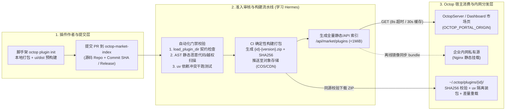

### **Pi Agent 与 Obsidian 分别代表了“npm 极简全能包自动索引”与“GitHub Release 预编译前端资产分发”两种截然不同的插件范式；四个生态标准各异，根本原因在于插件市场本质上是宿主进程拓扑、安全信任边界与上游语言包管理设施的直接投影。针对腾讯开源的 Octop（其最新主干已落地 `plugin.yaml` + `setup(ctx)` 契约及 `/api/market/*` 市场客户端协议），开发插件市场无需推翻底层加载器，而应围绕其现有的“预构建单根 ZIP + 双 Origin 源站隔离”协议构建带静态扫描与版本治理的市场服务端及投稿流水线；其核心标准与 Hermes Agent 最为同源，市场定位应聚焦于“面向私有化多用户团队与国内 IM 协同的开箱即用型全栈能力与行业专家交付中心”。**

---

### **一、 补齐最后两块拼图：Pi Agent 与 Obsidian 的插件及市场标准深度解剖**

结合前序已拆解的 **Hermes Agent** 与 **DeepSeek Harness (dsh)**，我们先将 **Pi Agent** 与 **Obsidian** 的插件架构与市场运作机制完整还原：

#### **1. Pi Agent（`earendil-works/pi`，原 `@mariozechner/pi-coding-agent`）**
Pi 是由 Mario Zechner 打造的开源终端编程智能体（也是早期 OpenClaw 底层曾采用的 Harness 运行时），目前其官方市场 [Pi Package Catalog](https://pi.dev/packages) 已收录超过 **5,350 个扩展包**。它的设计哲学极其激进：**核心只内置 `read`、`bash`、`edit`、`write` 四个工具与约 1,000 Token 的系统提示词**，连 MCP、子智能体（Sub-agents）、Plan 模式都不内置，全部交由扩展改造 Harness 本身。[AI Builder Club](https://www.aibuilderclub.com/blog/pi-agent-extensions-guide) [Pi](https://pi.dev/packages)
- **插件物理与代码标准**：完全寄生于 Node.js / TypeScript 生态。一个 **Pi Package** 本质上就是一个普通的 npm 包或 Git 仓库，无需发明新清单文件，直接在 `package.json` 中加上 `"keywords": ["pi-package"]`，并通过约定目录（`extensions/`、`skills/`、`prompts/`、`themes/`）或 `package.json` 下的 `"pi"` 字段声明资源路径。代码入口是导出默认工厂函数的 TypeScript 模块 `export default function (pi: ExtensionAPI) { ... }`，直接运行在宿主同一进程内，可调用 `pi.registerTool()`、`pi.registerCommand()`、`pi.registerProvider()`，甚至监听 `session_before_compact` 彻底重写上下文压缩算法或重绘终端 TUI。[GitHub](https://github.com/earendil-works/pi/blob/main/packages/coding-agent/docs/packages.md)
- **依赖与作用域治理**：宿主自带的核心库（如 `@earendil-works/pi-coding-agent`、`typebox`）强制要求声明在 `peerDependencies` 中（用 `"*"`），严禁打入 `dependencies` 以免在编译后的 ESM 中产生重复实例；支持全局（`~/.pi/agent/settings.json`）、项目级（`.pi/settings.json`，需通过项目信任门禁后才加载）以及单次临时试用（`pi -e npm:@foo/bar`）。
- **插件市场机制**：**零人工审批的自动化注册表爬虫模式**。开发者只需往公共 npm 发布带 `pi-package` 关键词的包，`pi.dev/packages` 就会自动抓取索引并统计月下载量；安全完全交由用户自负（如同安装普通 npm 包，拥有当前系统完整权限），社区甚至衍生出 `pi-marketplace` 这类在安装前做源码扫描的“市场插件”。

#### **2. Obsidian（`obsidianmd/obsidian-releases`，桌面/移动端本地知识库）**
Obsidian 拥有超过 **9,300 个社区插件**，是纯客户端 Electron / Mobile 应用插件市场的标杆。[GitHub](https://github.com/obsidianmd/obsidian-releases) [APIs.io](https://apis.io/markets/obsidian-community-plugins)
- **插件物理与代码标准**：**纯编译产物分发，零源码、零运行时装包**。每个插件安装到用户知识库 `.obsidian/plugins/<id>/` 下时，严格只包含三个文件：`manifest.json`（声明 `id`、`version`、`minAppVersion`、`isDesktopOnly`）、`main.js`（开发者本地用 esbuild/Rollup 将所有 npm 依赖打包进同一个 CommonJS 单文件）以及可选的 `styles.css`。代码继承 `Plugin` 基类，实现 `onload()` 与 `onunload()`（利用 `this.registerEvent()` 等辅助方法确保禁用插件时 DOM 监听与命令被干净卸载）。
- **插件市场机制**：**中心化 GitHub PR 初审 + 作者 GitHub Releases 直连分发**。官方维护 `obsidianmd/obsidian-releases` 仓库中的静态 `community-plugins.json`（仅存 `id`、`name`、`author`、`description`、`repo`）与 `community-plugins-removed.json` 下架黑名单。只有**首次上架**需要提 PR 接受官方人工代码审查；一旦入库，后续发版完全无需经过官方仓库——作者只需在自己仓库打一个与 `manifest.json` 版本号同名的 GitHub Release Tag 并上传 `main.js` 三件套，客户端比对 `versions.json`（宿主最低版本兼容映射表）后直接从 GitHub Releases 拉取资产。

---

### **二、 为什么四个平台的插件标准都不一样？设计一个插件市场的根本依据是什么？**

把 **Obsidian、Pi Agent、DeepSeek Harness (dsh)、Hermes Agent** 放在同一张坐标系里横向对比，就能清楚看到：**世界上不存在“放之四海而皆准”的通用插件标准，因为插件标准本质上是“宿主运行时架构 + 安全爆炸半径 + 目标终端用户画像”的函数映射。**

| 对比维度 | Obsidian | Pi Agent (`pi.dev`) | DeepSeek Harness (`dsh`) | Hermes Agent |
|---|---|---|---|---|
| **宿主架构形态** | 纯本地 Electron / 移动端 GUI 客户端 | 单人本地终端 CLI / TUI (Node/Bun) | 基于 Cordis IoC 的模块化双平面运行时 | 多渠道共享后台 Gateway 守护进程 (Python) |
| **清单与入口标准** | `manifest.json` + 预打包单文件 `main.js` (`onload`/`onunload`) | 复用 `package.json` (`pi` 字段) + TS 源码 `default (pi)` | `package.json` (`dsh.bundle`) + `cordis.patch.yml` + `apply(ctx)` | `plugin.yaml` (Manifest v2) + `__init__.py` `register(ctx)` |
| **依赖解决方式** | 构建期全部 Bundle 进 `main.js`，客户端不跑 npm | 客户端调用 npm/bun 实时拉取，`peerDependencies` 防重 | Cordis 依赖注入图解析，HMR 秒级重编排 | 宿主内置 `uv`/PM 与核心锁文件做事务性联合求解 |
| **市场索引与分发** | 官方 `community-plugins.json` + 作者 GitHub Releases | 自动抓取 npm `pi-package` 关键词，npm/git 直装 | 官方不管市场；社区爬虫扫 GitHub/npm `dsh-plugin` 聚合 | 官方 `plugin-catalog/*.yaml` 人工合并 + **40 位 Git SHA 锁死** |
| **信任与安全模型** | 首次上架人工审核，后续发版信任作者 Tag；有“安全模式”总开关 | 完全开放免审，等同 `npm install`，靠项目级 Trust 确认 | 副作用可逆回收 + 崩溃独立进程恢复页（防单插件挂死宿主） | **每次升级 SHA 均需重审 PR** + 安装期静态威胁扫描 + 可选子进程隔离 |

为什么它们绝不可能共用同一套标准？这背后对应着**设计任何一个插件市场都必须回答的五大底层依据**：

1. **依据一：目标受众的终端环境（“用户机器上有没有编译器和包管理器？”）**
   Pi Agent 的用户 100% 是终端里的程序员，机器上必有 Node/Git，所以直接发 `.ts` 源码和 `npm:` 协议最轻便；而 Obsidian 的用户大量是写笔记的文科生、移动端 iOS/Android 用户，手机上根本没有 Node.js 和编译器，因此**必须强制要求开发者在发布前把所有代码编译打包成零依赖的 `main.js` 静态产物**。
2. **依据二：进程拓扑与故障隔离半径（“一个烂插件会不会把整个服务搞崩？”）**
   Pi 是单次会话进程，崩了重开即可；但 `dsh` 是“万物皆插件”的全量启动模型，一旦某个插件报错就会导致整个 Web 宿主起不来（连关掉坏插件的后台界面都打不开，逼得社区市场专门写了一个脱离主进程的急救恢复页，通过改写 `cordis.patch.yml` 自救）[GitHub](https://github.com/dsh-market/dsh-market)；而 Hermes 与 Octop 是长驻后台服务多个聊天渠道的共享守护进程，因此必须引入超时熔断、错误隔离和声明式权限清单。
3. **依据三：供应链信任锚点（“谁为插件升级后的投毒负责？”）**
   这是 Obsidian 与 Hermes 最核心的分水岭。笔记软件插件偶发恶意代码的破坏面主要在单机文档；而 AI Agent 手握 Shell 执行权、API 密钥、各大 IM 账号甚至支付钱包，一旦某个已上架插件在 `v1.0.1` 悄悄塞入窃取 `.env` 的代码，后果是灾难性的。因此 Hermes 彻底放弃了 Obsidian 式的“首审放行、后续免审发 Release”，转而采用极其严苛的 **40 位 Commit SHA 不可变锁死 + 禁绝自更新代码**——哪怕作者改一行代码，不提新 PR 过审，全网用户的 `update` 就绝不会拉取新代码。
4. **依据四：副作用可逆性与生命周期模型（“能不能在不断连的情况下热开关？”）**
   如果宿主追求不重启秒级热插拔（如 `dsh` 依赖 Cordis 的上下文作用域自动回收，Obsidian 依赖 `Plugin.register*` 自动清理 DOM），插件 API 就必须设计成强约束的声明式/托管式句柄；反之，若允许按组件差量重载或新会话生效，API 就可以更直观贴近原生函数。
5. **依据五：商业与私有化网络边界（“客户能不能连公网 GitHub / npm？”）**
   海外极客工具（Pi、Obsidian、Hermes）默认假设用户能畅通访问 GitHub Raw、GitHub Releases 和 npm；但面向国内团队、NAS 玩家与政企内网的自托管平台，如果把市场强耦合在 GitHub API 或运行时 `npm install` 上，在离线/内网环境下会大面积瘫痪。

---

### **三、 深度对标 Octop 现状：标准和谁最像？应该如何精准定位？**

通过直接检视 `TencentCloud/Octop` 仓库的最新主干代码与架构文档（特别是近两周刚合入的 PR `#2418`、`plugins/README.md`、`docs/plugin-package.md`、`docs/private-market.md`），我们可以看到一个非常关键的事实：**Octop 团队已经在底层 `octop-harness` 和 `OctopServer` 中把插件包规范、本地加载器以及客户端拉取远程市场的 HTTP 契约打好了地基！**[GitHub](https://github.com/TencentCloud/Octop/tree/main/plugins) [GitHub](https://github.com/TencentCloud/Octop/blob/main/docs/plugin-package.md) [GitHub](https://github.com/TencentCloud/Octop/blob/main/docs/private-market.md)

我们先看清 Octop 当前已定型的原生插件底座：
- **插件包格式**：单根 ZIP 压缩包（上限 100 MiB，解压上限 64 MiB，防 Zip Bomb 压缩比校验），解压至 `~/.octop/plugins/<id>/`。
- **清单与入口**：`plugin.yaml`（含 `id`、`version`、`name`、`description`、`kind`、`entry`、`requires`、`icon`、`group`、`ui`）+ `main.py` 中的 `def setup(ctx):`。
- **四大强分类 `kind`**：严格限定为 `tool`（`ctx.tool(...)`）、`skill`（`ctx.skills("skills")`）、`hook`（`ctx.middleware(...)`，挂载到 LangGraph 调用链）和 `channel`（`ctx.channel(...)`，动态扩展 `octop-gateway` 的 IM 通道，且开关时仅差量重启变更的通道，不影响内置飞书/企微连接）。
- **前后端一体卡片 UI**：支持 `ui/dist/index.js` + `ui/dist/manifest.json` 预构建 ESM（安装期**绝不执行 `npm install`**），宿主通过 `window.__OCTOP_REACT__` 共享运行时，工具返回 `"octop_ui"` JSON 即可在聊天流中渲染 L1 流式 / L2 可交互的富媒体卡片。
- **三市场分立的客户端协议**：Octop 在架构上其实划分了三个独立的生态入口——**插件市场**（`GET {OCTOP_PORTAL_ORIGIN}/api/market/plugins`）、**专家市场**（`GET {OCTOP_PORTAL_ORIGIN}/api/market/experts`，分发包含 `SOUL.md` + `skills/` + 子 Agent 的完整数字员工包）以及**技能市场**（默认对接 `api.skillhub.cn`）。

#### **1. 它的标准和 4 个中的哪个最像？**
结论非常明确：**底层契约架构 75% 像 Hermes Agent，前端产物与离线打包分发策略 25% 吸收了 Obsidian 的精髓，而与 Pi Agent、dsh 路线截然相反。**

- **为什么内核最像 Hermes Agent？** 两者同为 Python 3.12+ 单进程整合网关（Web + 多路 IM + Cron 共享运行时），都面临多租户/多 Agent 权限隔离与外部凭据管理问题；因此都采用了 **`plugin.yaml` 声明式清单 + Python 入口函数注入上下文句柄（Octop 的 `setup(ctx)` 对应 Hermes 的 `register(ctx)`）+ 表单 Schema 驱动后台配置页（Octop 的 `config_fields` / `fields` 对应 Hermes 的 `config_schema`）** 的设计，甚至 Octop CLI 还内置了 `octop migrate hermes` 一键迁移命令。[GitHub](https://github.com/TencentCloud/Octop/blob/main/docs/cli.md)
- **为什么打包分发融合了 Obsidian 的思路？** Octop 部署场景涵盖 Windows/macOS 桌面安装包、Docker 容器、腾讯云轻量服务器以及**飞牛 NAS（FnOS）** 等轻量家庭/内网主机。这些机器往往没有 Node.js 编译链，访问 GitHub Raw 也可能受阻。因此 Octop 没有采用 Hermes 的“客户端现场 `git clone` 仓库”或 Pi 的“现场 `npm install`”，而是像 Obsidian 一样采用**预构建好的静态 ZIP 包直链下载（内含编译好的 `ui/dist/index.js`）**，通过双环境变量 `OCTOP_PORTAL_ORIGIN`（目录源）与 `OCTOP_MARKET_REMOTE_ORIGIN`（ZIP 下载源）实现公网与纯内网镜像的无缝切换。
- **比 Hermes 更克制的差异点**：Hermes 允许一个插件在 `register(ctx)` 里同时混装工具、27 种细粒度钩子、斜杠命令和底层 Provider，灵活但复杂度极高；Octop 则做了**“单一职责强分类（Single-kind Contract）”**——一个插件在 `plugin.yaml` 里选定了 `kind: tool`，它的 `setup(ctx)` 里就只允许调 `ctx.tool()`，心智负担和静态审计难度大幅降低。

#### **2. Octop 插件市场应该怎么定位？**
结合 Octop **“支持多用户 JWT 隔离、多 Agent 专家协同（AgentTeams）、深度适配微信/企微/飞书/钉钉/QQ 及飞牛 NAS”** 的独特基因，它的插件市场绝不能做成 Pi 那种“极客改写底层编译器的零件铺”，而应定位为：

**“面向家庭私有云（NAS/PC）与中小团队内网的‘全栈能力积木 + 场景数字员工’双轮驱动应用商店”**

在生态分工上，建议确立清晰的**四层边界定位**，避免开发者困惑“我到底该写插件、MCP、Skill 还是 Expert”：
1. **Connectors / MCP 层（连接外部 SaaS 资源）**：无状态的第三方 API 读写（如腾讯文档、Notion、滴答清单），优先走内置 OAuth Connector 或标准 MCP，不重复造插件轮子。
2. **Skill 市场层（纯提示词与 SOP 知识）**：零代码的工作流指令（`SKILL.md`），复用 SkillHub 生态，按 Agent 挂载。
3. **Plugin 市场层（突破运行时边界的“硬核组件”）**：重点发力三大不可替代方向——**① 带 `octop_ui` 交互卡片的工具插件**（如股票行情看板、服务器监控面板、B 站追番日历、审批表单，直接在聊天窗口交互）；**② 本土化与垂直长尾 `channel` 通道插件**（如私有化部署的内部 IM、物联网 MQTT 面板、特定客服系统接入）；**③ 企业合规与治理 `hook` 中间件插件**（如自定义敏感词审计、部门 Token 配额熔断、内部日志归档）。
4. **Expert 专家市场层（开箱即用的“成品数字员工”）**：把人格（`SOUL.md`）、快捷指令（`quick_prompts`）、定时巡检示例与所需插件/技能打包成行业专家（如“K8s 值班 SRE”、“电商大促客服主管”、“家庭财务管家”），让非技术团队成员一键雇佣。

---

### **四、 给 Octop 开发完整插件市场的工程落地路线图**

既然 Octop 客户端侧已经写好了拉取 `/api/market/plugins` 与 `/api/market/experts`、缓存 30 秒并校验同源 `download_url` 的代码，你现在要为 Octop 打造一个真正可用的官方/企业级插件市场，核心任务不再是改写 `octop-harness` 加载器，而是**向上补齐“市场注册中心（Registry & Portal）+ 安全准入流水线（CI Gate）+ 宿主端安全与版本增强”这三块拼图**。

具体可分为以下四个阶段推进开发：

#### **第一阶段：严格对齐现有客户端契约，搭建“静态优先 + CDN 加速”的市场服务端（MVP 1~2 周可上线）**
仔细阅读 `docs/private-market.md` 的硬约束可以发现一个极具性价比的架构捷径：**Octop 进程请求市场目录时既不带查询参数（搜索和分组筛选全部在客户端本地完成），也不带用户 Token，且要求单次响应 `≤ 1 MiB`、`8 秒` 内返回**。[GitHub](https://github.com/TencentCloud/Octop/blob/main/docs/private-market.md)
这意味着你的市场服务端**根本不需要在读路径上查数据库**！最佳实践是采用 **“GitOps 索引仓库 + 对象存储（腾讯云 COS）+ 边缘 CDN”** 架构：
- **目录接口生成**：建立官方索引仓库（如 `octop-market-registry`），每次合并插件上架/更新 PR 时，由 CI 编译生成严格符合 OpenAPI 契约的 JSON 文件（顶层 `{"success": true, "data": {"items": [...]}}`），直接发布到 `{OCTOP_PORTAL_ORIGIN}/api/market/plugins` 与 `/api/market/experts`。
- **严守四条协议红线**：
  1. 目录条目中的 `id` 与 `version` 必须与 ZIP 包内 `plugin.yaml` 中的字段**逐字符完全一致**，否则 Octop 安装器会直接报错拦截；
  2. 所有插件的 `download_url` 协议、域名、端口必须统一落在 `{OCTOP_MARKET_REMOTE_ORIGIN}` 下（例如统一托管到 `https://download.octop.cloud/octop/market/plugins/{id}/{version}/{id}-{version}.zip`），**切勿直接填作者五花八门的 GitHub Releases URL**，否则会触发 Octop 服务端严格的同源防 SSRF 校验而拒绝下载，同时集中托管在腾讯云 COS 还能彻底解决国内用户拉取 GitHub 慢的痛点；
  3. `name` 与 `description` 统一使用双语对象 `{"zh": "...", "en": "..."}`，`group` 优先使用内置已汉化的八大分类（`tools`、`ops`、`finance`、`media`、`news`、`lifestyle`、`fun`、`games`），`updated_at` 统一使用标准 ISO-8601 UTC 时间戳以保证客户端最新排序正确；
  4. 控制全量 JSON 体积（当未来插件超过 1,500 个逼近 `1 MiB` 上限时，再平滑升级协议支持分页与服务端检索）。

#### **第二阶段：借鉴 Hermes 信任模型，构建自动化准入扫描与确定性打包流水线（CI Gate）**
绝不能允许作者直接上传黑盒 ZIP 包——因为 ZIP 里可能夹带篡改过的前端脚本、未声明的二进制木马或与源码不符的后门。应借鉴 Hermes Catalog 的做法，实行 **“源码仓库 + 固定 40 位 Commit SHA 投稿，由官方 CI 洁净室构建 ZIP”**：
1. **结构与加载器实测校验**：CI 拉取指定 SHA 源码后，首先校验单根目录规则、体积配额（`≤ 64 MiB`）、无路径穿越（`..`），并在沙箱中调用 `octop_harness.plugins.load_plugin_dir(path, install_deps=False)`，确认 `plugin.yaml` 合法、`setup(ctx)` 调用与声明的 `kind` 严格匹配（例如防止 `kind: tool` 插件越权修改全局中间件）。
2. **Python AST 与前端产物静态安全扫描**：扫描 Python 代码是否违规直接读写控制平面数据库 `octop.db`、是否绕过 `BackendWorkspace` 硬编码读写宿主敏感路径（如 `~/.octop/secrets/`、SSH 密钥）、是否包含未披露的高危反弹 Shell 或自更新逻辑；若含 `ui/`，在 CI 容器内从源码执行构建生成 `ui/dist/index.js`，校验其仅依赖宿主暴露的 `__OCTOP_REACT__` 且无恶意外部脚本注入。
3. **依赖兼容性预检**：由于 Octop 是单进程运行在 `~/.octop/venv` 中，插件的 `requires` / `requirements.txt` 若将 `fastapi`、`pydantic`、`langgraph` 降级或锁死冲突版本，会直接污染宿主环境。CI 必须拿当前版本 Octop 的 `uv.lock` 与插件依赖做一次 `uv pip compile / install --dry-run` 联合冲突测试，强制要求第三方插件声明合理的版本上下界。

#### **第三阶段：升级 Octop 宿主端的供应链安全、依赖管理与市场体验（客户端侧迭代）**
在现有 PR `#2418` 的基础上，建议在 `TencentCloud/Octop` 核心仓库继续补强五个关键工程细节：
1. **在市场协议与安装器中增加 `sha256` 完整性校验**：目前 `Plugin` 目录 Schema 必填项仅有 `id`、`version`、`download_url`。建议在 JSON 条目中新增 `sha256`、`author`、`repo_url`、`license`、`min_octop_version` 與 `permissions_disclosure`（权限与外联披露）字段（客户端向后兼容忽略未知字段）；下载 ZIP 后先校验 SHA-256 摘要再解压，形成闭环防篡改链路。
2. **将插件依赖安装从裸 `pip` 全面收敛至 `uv` 事务管理**：安装或启用带 `requires` 的插件时，复用 `~/.octop/` 内置的 `uv` 进行约束安装（传入宿主核心包的 constraints 文件锁定核心库版本不漂移），并在卸载插件时记录依赖引用计数。
3. **打通“插件 + 专家”联动安装体验**：目前专家市场里的行业专家如果依赖某个第三方工具插件（如“运维专家”依赖 `server-status` 插件），用户需要分别去两个页面手动装再进工具管理开启。可在 `manifest.json` 中支持 `recommended_plugins: ["server-status"]`，雇佣专家时一键提示并联动安装启用对应插件。
4. **多租户权限颗粒度细化**：严格维持当前“Admin 管理员在全局后台安装/升级插件代码，普通家庭成员或团队成员只能在自己的 Agent 工作区按需勾选启用已被 Admin 准入的工具/技能”的两级治理模型，防止多用户环境下某个普通账号上传恶意 Python 插件直接拿到宿主机进程权限。
5. **提供一键导出“内网离线市场镜像包”工具**：针对政企与 NAS 离线用户，在 CLI 增加类似 `octop plugin market-mirror --output /srv/market` 的工具，一键把精选插件目录 JSON、图标静态资源与对应 ZIP 包打包下载到本地目录，配合 Nginx 5 分钟即可拉起符合 `docs/private-market.md` 规范的局域网私有源。

#### **第四阶段：开发者工具链（DX）与首批标杆插件冷启动**
一个插件市场能否活起来，取决于写第一个插件要花 10 分钟还是半天：
- **脚手架与本地校验 CLI**：在 `octop plugin` 下新增 `octop plugin init --kind [tool|skill|hook|channel] --with-ui`（一键生成带 `plugin.yaml`、`main.py` 和 Vite 预置打包配置的模板）、`octop plugin doctor ./my-plugin`（本地一键跑完清单、签名、ZIP 体积与安全规则检查）以及 `octop plugin pack`（自动剔除 `__MACOSX`、`node_modules`、`.git` 打出合规单根 ZIP）。
- **首批官方标杆插件矩阵（冷启动种子）**：除了现有的 `bilibili-anime`、`server-status` 和四个 `demo-*` 外，建议围绕 Octop 的差异化场景率先推出 6~8 个官方精品插件——例如**带 `octop_ui` 可视化图表的家庭 NAS 硬件/Docker 状态监控卡**、**企微/飞书审批卡片双向回调插件**、**腾讯云轻量服务器（Lighthouse）一键巡检与快照工具**、**团队 Token 消耗日报与预算限流 Hook**。有了这些能直观秀出“聊天内交互卡片 + 多端 IM 联动”的样板，社区开发者自然会沿着这套标准快速跟进。

如果你接下来准备着手起草具体的市场后端架构设计文档，或者想针对某一个具体模块（比如 CI 静态安全扫描规则集、`plugin.yaml` v2 扩展字段草案、或是带 `octop_ui` 的插件开发模板）展开细节，我们可以直接针对该模块往下深挖。