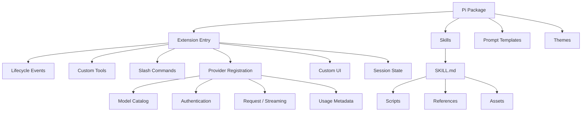

### **Pi Agent 的插件本质上是“运行时扩展模块”；针对 Magpie，最适合先做一个 Provider Extension，再按需要加入命令、额度查询和状态展示。**

Pi 的扩展通常由 TypeScript 模块组成，通过 `ExtensionAPI` 接入 Pi 的生命周期、工具、命令、模型供应商、会话状态和终端 UI。Magpie 本身又支持两种插件形态：一类是 Magpie 原生的 OpenCode-style provider plugin，另一类是能够调用 `pi.registerProvider()` 的 Pi Package。后者可以直接复用 Pi 的 Provider 机制。[Pi Extensions 文档](https://github.com/earendil-works/pi/blob/main/packages/coding-agent/docs/extensions.md) [Magpie Plugins 文档](https://usemagpie.ai/docs/plugins)

## **一、Pi Agent 插件由哪些基本部分组成**

从架构上看，一个 Pi 插件不是单一的“脚本”，而是下面几个层次的组合。



### **1. Extension 入口**

最小的 Pi 扩展通常是一个导出默认函数的 TypeScript 文件：

```ts
import type { ExtensionAPI } from "@earendil-works/pi-coding-agent";

export default function (pi: ExtensionAPI) {
  // 注册事件、命令、工具或 Provider
}
```

Pi 会自动发现以下位置的扩展：

```text
~/.pi/agent/extensions/*.ts
~/.pi/agent/extensions/*/index.ts
.pi/extensions/*.ts
.pi/extensions/*/index.ts
```

也可以通过命令临时加载：

```bash
pi -e ./extension.ts
```

放在自动发现目录中的扩展支持 `/reload` 热重载。[Pi Extensions 文档](https://github.com/earendil-works/pi/blob/main/packages/coding-agent/docs/extensions.md)

### **2. 生命周期事件**

事件是插件插入 Pi 的主要方式，覆盖了整个 Agent 生命周期：

```text
project_trust
session_start
resources_discover
input
before_agent_start
agent_start
turn_start
context
before_provider_headers
before_provider_request
after_provider_response
tool_call
tool_result
turn_end
agent_end
agent_settled
session_shutdown
```

典型用途包括：

| 事件或能力           | 常见用途                              |
| -------------------- | ------------------------------------- |
| `before_agent_start` | 注入上下文、修改系统提示              |
| `context`            | 在每次模型调用前过滤或修改消息        |
| `tool_call`          | 拦截危险命令、修改工具参数            |
| `tool_result`        | 修改工具结果、添加诊断信息            |
| `model_select`       | 模型切换时刷新状态                    |
| `session_start`      | 初始化资源、读取配置                  |
| `session_shutdown`   | 关闭连接、清理进程                    |
| `resources_discover` | 动态提供 Skills、Prompts、Themes 路径 |

如果 Magpie 插件只是“把 Magpie 暴露成一个模型 Provider”，不需要使用大部分事件；如果还要提供 `/magpie` 命令、状态栏、额度刷新，就会用到 `registerCommand`、`model_select`、`session_start` 和 `ctx.ui`。

### **3. 自定义工具**

插件可以注册让模型调用的工具：

```ts
import { Type } from "typebox";

pi.registerTool({
  name: "magpie_quota",
  label: "Magpie Quota",
  description: "查询当前 Magpie provider 的额度和重置时间",
  parameters: Type.Object({}),

  async execute() {
    return {
      content: [
        {
          type: "text",
          text: "Magpie quota information",
        },
      ],
      details: {},
    };
  },
});
```

工具需要注意几个基本问题：

- 参数必须有明确的 JSON Schema。
- 错误应该通过 `throw` 抛出，而不是返回普通文本。
- 大输出必须截断。
- 如果工具会修改文件，要使用 Pi 的文件变更队列。
- 如果工具包含嵌套模型调用，应返回 `usage`，否则 Pi 无法正确统计成本。
- 需要支持取消时，要使用传入的 `signal`。

### **4. Slash Command**

插件可以提供命令：

```ts
pi.registerCommand("magpie", {
  description: "查看或刷新 Magpie 网关状态",

  handler: async (args, ctx) => {
    if (args === "refresh") {
      ctx.ui.notify("Refreshing Magpie models...", "info");
      return;
    }

    ctx.ui.notify("Magpie is available", "info");
  },
});
```

用户可以这样调用：

```text
/magpie
/magpie refresh
/magpie quota
```

### **5. Provider**

Provider 是 Magpie-Pi 集成中最重要的一层。它负责把某个模型服务注册到 Pi 的模型目录中。

一个 Provider 至少需要表达：

```text
Provider ID
显示名称
Base URL
认证方式
API 协议
模型列表
模型能力
上下文窗口
最大输出
推理能力
输入类型
价格信息
模型刷新方式
请求和流式实现
```

Pi 支持的常见协议包括：

- Anthropic Messages
- OpenAI Chat Completions
- OpenAI Responses
- Google Generative AI
- Vertex AI
- Mistral Conversations
- Bedrock Converse

如果 Magpie 已经提供兼容协议，最好的设计不是自己实现流式协议，而是注册 Provider 后复用 Pi 内置的 API 实现。这样可以直接获得消息转换、工具调用、流式输出、usage 统计、取消和错误处理能力。[Pi Custom Providers 文档](https://github.com/earendil-works/pi/blob/main/packages/coding-agent/docs/custom-provider.md)

### **6. Skills**

Skill 不是可执行插件，而是按需加载的工作流指令包。

```text
magpie-ops/
├── SKILL.md
├── scripts/
│   ├── doctor.py
│   └── probe.py
├── references/
│   ├── gateway.md
│   ├── routing.md
│   └── troubleshooting.md
└── assets/
```

`SKILL.md` 需要包含：

```markdown
---
name: magpie-ops
description: Diagnose Magpie gateway, provider, routing, quota, and Pi connection problems.
---

# Magpie Operations

Use the bundled scripts to inspect the gateway and routing state.
```

Skill 适合承载：

- Magpie CLI 使用方法
- 路由组排障流程
- Provider 和模型配置说明
- 诊断脚本
- 常见错误和修复策略
- 面向模型的操作规范

你提供的 `pi-magpie-ops` 已经是一个相当标准的 Skill 结构：`SKILL.md` 负责路由和流程，`references/` 负责详细资料，`scripts/` 负责只读诊断。[pi-magpie-ops](https://github.com/nb95276/pi-magpie-ops)

## **二、Magpie 插件需要先区分三种目标**

“开发一个 Magpie 插件”可能对应三种完全不同的设计。

### **方向 A：Pi 连接 Magpie Gateway**

这是最适合入门、也最接近你当前材料的方向。

目标是：

```text
Pi → Magpie Gateway → Provider / Routing Group → 上游模型
```

插件负责：

- 注册 `magpie` Provider。
- 从 `GET /v1/models` 获取模型目录。
- 把 Magpie 模型转换成 Pi 的 Model 定义。
- 复用 Pi 的 Chat Completions、Responses 或 Anthropic API 实现。
- 处理 Gateway URL 和 Gateway Key。
- 提供 `/magpie refresh`、`/magpie quota` 等命令。
- 可选地在 footer 显示当前路由和额度。

已经存在的几个 Pi Package 很有参考价值：

- `pi-magpie`：本地 Magpie Gateway、模型目录、额度和路由组。
- `@fradser/pi-magpie`：动态读取 Magpie `/v1/models`，并支持 `/login magpie`。
- `@x-magpie/pi`：把 Magpie 作为动态 Provider，使用 `refreshModels`，并复用 Pi 内置的流式实现。

这些包的设计说明了一个事实：**Pi-Magpie 集成的核心不是重新实现 Agent，而是实现 Provider 适配层。** [pi-magpie](https://pi.dev/packages/pi-magpie) [@fradser/pi-magpie](https://pi.dev/packages/@fradser/pi-magpie) [@x-magpie/pi](https://pi.dev/packages/@x-magpie/pi)

### **方向 B：Magpie 原生 Provider Plugin**

目标是把某个新的上游服务接入 Magpie：

```text
Magpie → 你的 Plugin → 上游 API / 订阅 / 本地 CLI
```

此时插件通常实现 Magpie 的 provider plugin 接口：

```text
config
auth
provider.models
auth.loader
auth.usage
auth.refresh
auth.checkin
chat.headers
```

它可以提供：

- API Key 登录。
- OAuth 或设备码登录。
- 多账户。
- Token 刷新。
- 模型发现。
- 请求签名。
- 请求转发。
- 订阅额度查询。
- 每日签到。
- 失败转移。
- Provider 级并发限制。

Magpie 会把插件暴露成普通 Provider，例如：

```text
acme/acme-coder
```

Magpie 官方文档将 provider plugin 概括为：

```text
config       声明 Provider 和默认模型
auth         提供登录方法
loader       构造请求和 fetch
provider.models  获取账户模型
auth.usage   查询额度
auth.refresh 刷新登录态
auth.checkin 执行签到
```

插件运行在 Bun 宿主中，通过 JSON 消息与 Magpie 通信；Provider 请求最终返回原始 `Response`，包括状态码、Headers 和流式 Body。这样 Magpie 可以继续负责统一协议、路由、失败转移和统计。[Magpie Writing Plugins](https://usemagpie.ai/docs/plugins)

### **方向 C：Magpie Gateway Middleware**

目标不是添加 Provider，而是修改所有 Agent 的请求或响应：

```text
Agent → Gateway Middleware → Magpie Router → Provider
```

适合实现：

- 模型别名映射。
- 自动加入 System Prompt。
- 参数重写。
- 敏感词过滤。
- Thinking 标签转换。
- 请求拦截。
- 响应清洗。
- 自定义路由策略。
- 用量审计。

典型接口是：

```js
export function onRequest(body, ctx) {
  if (body.model === "fast") {
    body.model = "deepseek/deepseek-chat";
  }

  return body;
}

export function onResponse(body, ctx) {
  return body;
}

export function onEvent(event, ctx) {
  return event;
}
```

Middleware 的特点是轻量、低延迟、同步处理为主；它运行在 Magpie Gateway 内部，而不是 Bun Provider 宿主中。官方文档说明，请求 Hook、Provider Hook 和整个响应 Hook 通常有严格的时间预算，事件 Hook 的时间预算更短，因此不适合在里面执行慢速网络调用。[Magpie Plugins](https://usemagpie.ai/docs/plugins)

## **三、如果你的目标是“Pi 使用 Magpie”，推荐的整体设计**

推荐先做：

```text
Pi Provider Extension
    ├── 注册 magpie Provider
    ├── 动态刷新模型
    ├── 支持 gateway URL
    ├── 支持 gateway key
    ├── 复用 Pi 内置 API
    ├── 提供 /magpie 命令
    ├── 可选显示额度
    └── 打包为 Pi Package
```

不要第一版就做：

```text
自定义流式协议
完整 TUI
复杂 OAuth
自动修改 ~/.pi/agent/models.json
本地数据库
复杂缓存系统
跨平台桌面配置迁移
```

原因是 Magpie 已经承担了：

- 多 Provider。
- 多账户。
- 路由组。
- Failover。
- 额度和使用量。
- Gateway 协议翻译。
- Agent 配置接线。

Pi 插件只需将 Magpie 作为一个“动态模型 Provider”接入即可。

## **四、Magpie-Pi Provider 的核心数据模型**

你需要先定义一个内部配置对象：

```ts
export interface MagpieConfig {
  baseUrl: string;
  apiKey: string;
  api: "openai-completions" | "openai-responses" | "anthropic-messages";
  timeoutMs: number;
  refreshIntervalMs: number;
  modelFilter?: string[];
}
```

建议支持的配置优先级：

```text
环境变量
    ↓
共享配置文件
    ↓
Pi models.json
    ↓
Pi auth.json
    ↓
交互式 /login
    ↓
内置默认值
```

例如：

```text
MAGPIE_BASE_URL
MAGPIE_API_KEY
MAGPIE_API
MAGPIE_PI_MODELS
```

默认值可以是：

```text
Base URL: http://127.0.0.1:3425/v1
API Key: magpie
API: openai-completions
```

不过要注意：Magpie 的不同模型可能对应不同原生协议。一个模型可能应使用：

```text
OpenAI Chat Completions
OpenAI Responses
Anthropic Messages
Gemini
```

因此不应简单地对所有模型使用同一个 `baseUrl` 和同一个 API 类型。较好的设计是根据 Magpie `/v1/models` 返回的能力字段或模型元数据决定每个模型的 API。

## **五、模型目录需要获取哪些字段**

你需要先确认 Magpie 实际返回的 `/v1/models` 数据结构。最低限度应提取：

```ts
export interface MagpieModelRecord {
  id: string;
  name?: string;

  context_window?: number;
  max_output_tokens?: number;

  supported_reasoning_levels?: string[];
  reasoning?: boolean;

  input_modalities?: string[];
  output_modalities?: string[];

  native_endpoints?: string[];

  pricing?: {
    prompt?: string;
    completion?: string;
    input_cache_read?: string;
    input_cache_write?: string;
  };

  magpie_price?: {
    input?: number;
    output?: number;
    cacheRead?: number;
    cacheWrite?: number;
  };
}
```

映射到 Pi 的模型结构时，需要至少生成：

```ts
{
  id,
  name,
  reasoning,
  input: ["text"],
  cost: {
    input,
    output,
    cacheRead,
    cacheWrite,
  },
  contextWindow,
  maxTokens,
}
```

模型能力映射建议如下：

| Magpie 信息                  | Pi 字段         | 设计用途                             |
| ---------------------------- | --------------- | ------------------------------------ |
| `id`                         | `id`            | 请求中的模型 ID                      |
| `name`                       | `name`          | 模型选择器显示                       |
| `context_window`             | `contextWindow` | 上下文窗口                           |
| `max_output_tokens`          | `maxTokens`     | 最大输出                             |
| `supported_reasoning_levels` | 推理级别        | 控制 thinking level                  |
| `input_modalities`           | `input`         | 文本、图片等能力                     |
| `pricing`                    | `cost`          | Pi 成本统计                          |
| `native_endpoints`           | API 路由选择    | 选择 Chat、Responses 或 Messages     |
| `magpie_price`               | `cost`          | 使用 Magpie 实际价格，而不是厂商标价 |

特别要注意：**路由组是模型目录中的特殊模型。**

例如：

```text
group/daily-coding
group/opus-anywhere
auto/gemini-3.8-flash
```

它们对 Pi 来说仍然可以表现为普通 Model，但通常没有单一确定价格、单一 Provider 或单一原生 API。对于这类模型，建议：

```ts
cost: {
  input: 0,
  output: 0,
  cacheRead: 0,
  cacheWrite: 0,
}
```

或者明确记录为“价格未知”，不要从某个成员模型推断价格。

## **六、Provider 的推荐实现方式**

推荐顺序如下。

### **第一选择：只注册动态 Provider，复用 Pi 内置 API**

伪代码：

```ts
import type { ExtensionAPI } from "@earendil-works/pi-coding-agent";

export default async function (pi: ExtensionAPI) {
  const config = await loadMagpieConfig();

  pi.registerProvider("magpie", {
    name: "Magpie",
    baseUrl: config.baseUrl,
    apiKey: config.apiKey,
    api: config.api,
    models: [],

    async refreshModels({ signal }) {
      const response = await fetch(`${config.baseUrl}/models`, {
        headers: {
          Authorization: `Bearer ${config.apiKey}`,
        },
        signal,
      });

      if (!response.ok) {
        throw new Error(`Magpie model discovery failed: ${response.status}`);
      }

      const payload = await response.json();

      return payload.data.map((item: any) =>
        convertMagpieModel(item),
      );
    },
  });
}
```

这适合：

- Magpie 统一暴露 OpenAI-compatible 接口。
- 你希望 Pi 自己处理消息、工具调用和流式输出。
- 你不需要重写协议。
- 你只需要动态模型目录。

### **第二选择：注册完整的 Pi AI Provider**

如果需要：

- 根据模型动态选择协议。
- 自定义认证。
- 自定义请求 Headers。
- 自定义模型过滤。
- 多账户。
- 动态 Provider 状态。
- 自定义流式行为。

则应该使用 `@earendil-works/pi-ai` 的完整 Provider 类型，而不是旧式配置对象。

### **第三选择：自定义 `streamSimple`**

只有在 Magpie 或中间服务使用 Pi 内置 API 无法表达的协议时才使用。

自定义流式实现必须处理：

1. 请求建立。
2. `start` 事件。
3. 文本流。
4. 思考流。
5. 工具调用流。
6. Unicode 边界。
7. usage。
8. stop reason。
9. abort。
10. error。
11. `done` 或 `error` 唯一终止事件。

这部分容易出现缓存、工具调用和上下文错误，第一版不建议实现。

## **七、登录和认证设计**

如果 Magpie 只在本机运行，可以先支持无交互默认配置：

```text
http://127.0.0.1:3425/v1
Bearer magpie
```

如果要支持远程 Magpie，则需要实现 `/login magpie`。

登录流程应当是：

```text
用户执行 /login magpie
        ↓
询问 Gateway URL
        ↓
询问 Gateway Key
        ↓
请求 GET /v1/models
        ↓
请求 GET /v1/magpie/quotas 或轻量探测
        ↓
验证成功后写入 auth.json
        ↓
刷新模型目录
```

关键原则是：

- URL 和 Key 独立保存。
- 验证失败时不要保存半成品配置。
- 不要把 Key 写入普通日志。
- 不要把 Key 放入模型描述。
- 远程 Gateway 使用 HTTPS。
- 远程 Gateway 的 key 不应硬编码成 `magpie`。
- 如果 Gateway 返回 401、403，应显示清晰错误。
- 如果 `/v1/models` 可访问但真实 completion 失败，不要把它判定为完全健康。

可以提供：

```text
/magpie endpoint
/magpie refresh
/magpie health
/magpie quota
```

其中 `/magpie health` 最好同时检查：

```text
模型目录可访问
Gateway key 有效
至少一个模型存在
必要时发送一次极小 completion
```

你提供的运维 Skill 已经明确指出：`/v1/models` 只能说明本地登记了模型，不能证明上游 Provider 健康；真正的路由验证需要看真实请求耗时和返回的 `model` 字段。[pi-magpie-ops](https://github.com/nb95276/pi-magpie-ops)

## **八、额度和路由状态怎么设计**

Magpie 的优势不只是模型转发，而是额度和路由。因此插件可以分两个阶段。

### **第一阶段：只展示模型**

实现：

```text
/magpie
/magpie refresh
/magpie endpoint
```

### **第二阶段：展示额度**

调用类似：

```text
GET /v1/magpie/quotas?kept=1
```

展示：

```text
Provider
Account
Plan
Used
Remaining
Reset time
Model scope
```

可以在 footer 中显示：

```text
magpie 14% left · reset 3d
```

也可以使用：

```ts
ctx.ui.setStatus("magpie", "14% left · reset 3d");
```

### **第三阶段：展示路由结果**

可以读取：

```text
当前模型
当前路由组
路由策略
最后实际服务的 Provider
最后实际服务的 Model
请求耗时
是否发生 Failover
```

例如：

```text
smart → opencode-go
order → antigravity/gemini-3.8-flash
```

注意：远程 Magpie 不一定允许访问本机路由 trace；因此这类功能应当是“可选能力”，不能作为 Provider 正常工作的必要条件。

## **九、Pi Package 项目结构**

推荐项目结构：

```text
pi-magpie/
├── package.json
├── README.md
├── LICENSE
├── CHANGELOG.md
├── extensions/
│   └── magpie.ts
├── src/
│   ├── config.ts
│   ├── gateway.ts
│   ├── models.ts
│   ├── provider.ts
│   ├── auth.ts
│   ├── commands.ts
│   ├── quota.ts
│   ├── routing.ts
│   └── format.ts
├── skills/
│   └── magpie-ops/
│       ├── SKILL.md
│       ├── scripts/
│       └── references/
├── prompts/
│   └── magpie-review.md
├── examples/
│   └── settings.json
└── tests/
    ├── models.test.ts
    ├── gateway.test.ts
    ├── auth.test.ts
    └── provider.test.ts
```

最小 Package：

```json
{
  "name": "pi-magpie",
  "version": "0.1.0",
  "description": "Dynamic Magpie gateway provider for Pi",
  "type": "module",
  "keywords": ["pi-package", "pi", "magpie", "provider"],
  "license": "MIT",
  "pi": {
    "extensions": ["./extensions/magpie.ts"],
    "skills": ["./skills"]
  },
  "peerDependencies": {
    "@earendil-works/pi-coding-agent": "*",
    "@earendil-works/pi-ai": "*",
    "typebox": "*"
  }
}
```

Pi Package 的资源可以放在约定目录中，也可以通过 `pi` 字段显式声明：

```json
{
  "pi": {
    "extensions": ["./extensions"],
    "skills": ["./skills"],
    "prompts": ["./prompts"],
    "themes": ["./themes"]
  }
}
```

运行时依赖放在 `dependencies`，宿主提供的 Pi 包放在 `peerDependencies`，不要把宿主包复制进自己的 `dependencies`，否则可能产生重复的类型、Registry 和运行时实例。[Pi Packages 文档](https://github.com/earendil-works/pi/blob/main/packages/coding-agent/docs/packages.md)

## **十、研究现有项目时要获取哪些基本要素**

建议把研究拆成四张表。

### **表一：Pi Extension API 表**

你需要确认：

```text
ExtensionAPI 版本
registerProvider 签名
ProviderConfig 类型
完整 Provider 类型
refreshModels 签名
模型定义类型
认证 API
事件名称
命令注册方式
UI API
热重载行为
模式差异：TUI / RPC / JSON / Print
```

重点查看：

- `docs/extensions.md`
- `docs/custom-provider.md`
- `docs/models.md`
- `examples/extensions`
- `packages/ai/src/api`
- `packages/coding-agent/src`

### **表二：Magpie Gateway 表**

需要确认：

```text
默认监听地址
Gateway URL 规则
Gateway Key 规则
GET /v1/models
POST /v1/chat/completions
POST /v1/responses
POST /v1/messages
GET /v1/magpie/quotas
GET /v1/magpie/trace
错误格式
流式格式
模型字段
路由组字段
价格字段
原生 API 字段
远程访问和 HTTPS
```

尤其要通过真实请求验证：

```bash
curl http://127.0.0.1:3425/v1/models

curl http://127.0.0.1:3425/v1/magpie/quotas?kept=1

curl -N http://127.0.0.1:3425/v1/chat/completions \
  -H "Authorization: Bearer magpie" \
  -H "Content-Type: application/json" \
  -d '{
    "model": "某个真实模型",
    "messages": [
      {"role": "user", "content": "say OK"}
    ],
    "stream": true,
    "max_tokens": 16
  }'
```

确认返回的：

```text
HTTP 状态
Content-Type
SSE event 格式
data 格式
[DONE]
usage
model
finish_reason
错误结构
```

### **表三：Magpie Plugin API 表**

如果要做 Magpie 原生 Provider Plugin，需要确认：

```text
config hook
auth hook
api key method
OAuth method
prompts
authorize
loader
fetch
provider.models
auth.usage
auth.refresh
auth.checkin
chat.headers
account identity
sign-in failure semantics
multi-account behavior
proxy behavior
concurrency behavior
```

需要明确：

```text
401 是否表示登录失效
403 是否表示模型不可用
429 是否触发账户休息和 Failover
怎样标记 signIn expired
怎样保留旧模型目录
怎样保存账户级 token
```

### **表四：产品设计表**

真正开发前要回答：

```text
插件解决的是谁的问题？
是 Pi 接入 Magpie，还是 Magpie 接入新的 Provider？
是否需要远程 Gateway？
是否需要多账户？
是否需要额度？
是否需要路由 trace？
是否需要自动刷新？
是否需要修改 Pi models.json？
是否需要兼容 Claude Code / OpenCode？
是否需要支持 Windows？
是否需要支持 CI / Print Mode？
是否需要提供 Skill？
```

## **十一、建议的开发路线**

### **阶段 0：先验证 Magpie API**

不要先写 Pi 代码。先用 curl 或 Node 脚本确认：

```text
/v1/models
/v1/chat/completions
/v1/responses
/v1/messages
/v1/magpie/quotas
```

同时确认一个真实模型和一个真实路由组。

### **阶段 1：只做静态 Provider**

先写死：

```text
baseUrl
apiKey
api
一个模型
```

目标是确认 Pi 能完成：

```text
普通文本
流式输出
工具调用
工具结果
错误返回
取消请求
```

### **阶段 2：加入动态模型刷新**

实现：

```text
GET /v1/models
refreshModels
模型过滤
模型上下文窗口
推理级别
图片能力
价格
```

此时不做额度和 UI。

### **阶段 3：加入配置和登录**

实现：

```text
/login magpie
/logout magpie
/magpie endpoint
环境变量
auth.json
远程 URL
Gateway Key
```

### **阶段 4：加入命令和状态栏**

实现：

```text
/magpie
/magpie refresh
/magpie quota
/magpie group
ctx.ui.setStatus()
```

### **阶段 5：加入 Magpie Skill**

把以下内容放入 Skill：

```text
Magpie 三层故障模型
Gateway 检查
Provider 检查
Routing Group 检查
真实请求探测
Pi 接线检查
模型不生效排查
响应慢排查
额度耗尽排查
```

### **阶段 6：打包和发布**

先本地安装：

```bash
pi install ./pi-magpie
```

然后测试：

```bash
pi -e ./extensions/magpie.ts
```

最后发布 npm：

```bash
npm publish
```

用户安装：

```bash
pi install npm:pi-magpie
```

## **十二、必须覆盖的测试矩阵**

至少测试以下情况：

| 类别     | 测试项                                          |
| -------- | ----------------------------------------------- |
| 网络     | Gateway 正常、端口关闭、连接超时                |
| 认证     | 正确 Key、错误 Key、远程 Key                    |
| 模型     | 空目录、单模型、路由组、模型下线                |
| 协议     | Chat Completions、Responses、Anthropic Messages |
| 流式     | 普通文本、空文本、Unicode、分块边界             |
| 工具     | 工具调用、多个工具、工具结果                    |
| 错误     | 400、401、403、404、429、500                    |
| Agent    | 继续会话、新会话、分支会话                      |
| Pi 模式  | TUI、RPC、JSON、Print                           |
| 生命周期 | `/reload`、退出、Provider 刷新                  |
| 额度     | 有额度、额度未知、已耗尽、重置时间              |
| 路由     | order、smart、rotate、failover                  |
| 安全     | 不记录 key、不输出 prompt、不泄露响应体         |

Pi 官方的 Provider 文档也特别强调了空文本、工具调用、图片、usage、abort、上下文溢出、畸形流、Unicode 和跨 Provider 会话切换等测试项。[Pi Custom Providers](https://github.com/earendil-works/pi/blob/main/packages/coding-agent/docs/custom-provider.md)

## **十三、我建议你的第一版 MVP**

可以把第一版严格限定为下面这些能力：

```text
1. 注册 magpie Provider
2. 默认连接 127.0.0.1:3425/v1
3. 支持 MAGPIE_BASE_URL 和 MAGPIE_API_KEY
4. 从 /v1/models 动态读取模型
5. 复用 Pi 内置 OpenAI Chat Completions 流式实现
6. 支持 /login magpie
7. 支持 /magpie refresh
8. 支持 /magpie endpoint
9. 支持基本错误提示
10. 支持模型过滤
11. 不实现自定义 stream
12. 不修改用户原有 models.json
13. 不实现额度和 TUI
```

第一版成功标准是：

```text
Pi 启动后能看到 Magpie 模型；
模型列表能够刷新；
普通对话能够流式返回；
工具调用正常；
错误能正确显示；
Magpie 停止时 Pi 不崩溃；
远程 Gateway 的 URL 和 Key 能安全保存；
/reload 后状态不重复注册。
```

其中“不要修改用户原有 `models.json`”很重要。现有 Pi-Magpie 包的经验表明，如果 Magpie 自己写入一个带固定 `models` 数组的 `models.json` Provider，可能覆盖扩展的动态目录和原生 API 信息。更稳妥的做法是让扩展负责动态 Provider，把 `models.json` 只作为用户显式配置来源。[ @fradser/pi-magpie](https://pi.dev/packages/@fradser/pi-magpie)

## **最终的设计判断**

如果你说的“Magpie 插件”是为了让 Pi 使用 Magpie，那么核心组件应当是：

```text
Pi Package
  └── Extension
      ├── Provider Registration
      ├── Model Discovery
      ├── Gateway Authentication
      ├── Protocol Selection
      ├── Optional Quota Reader
      ├── Optional Routing Reader
      ├── Slash Commands
      ├── Optional Footer Status
      └── Optional Magpie Operations Skill
```

如果你说的“Magpie 插件”是为了把新的模型服务接入 Magpie，那么核心组件应当是：

```text
Magpie Provider Plugin
  ├── package.json
  ├── config
  ├── auth
  ├── provider.models
  ├── loader
  ├── fetch
  ├── usage
  ├── refresh
  ├── checkin
  └── tests
```

如果是改变所有 Agent 的请求行为，则应当做：

```text
Magpie Gateway Middleware
  ├── onRequest
  ├── onProvider
  ├── onAccount
  ├── onEvent
  ├── onResponse
  ├── options
  └── timeout / failure isolation
```

对你当前的研究方向，最合理的顺序是：**先研究 `@fradser/pi-magpie` 和 `@x-magpie/pi` 的 Provider 实现，再研究 Magpie 官方 plugin guide，最后决定是否把额度、路由诊断和 `pi-magpie-ops` Skill 合并成一个完整 Pi Package。**
